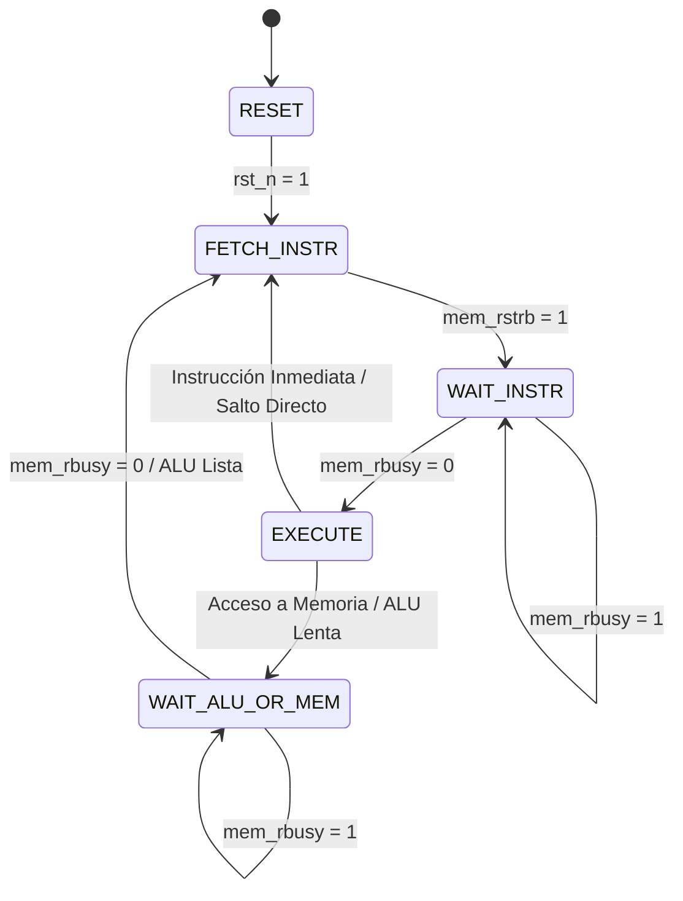
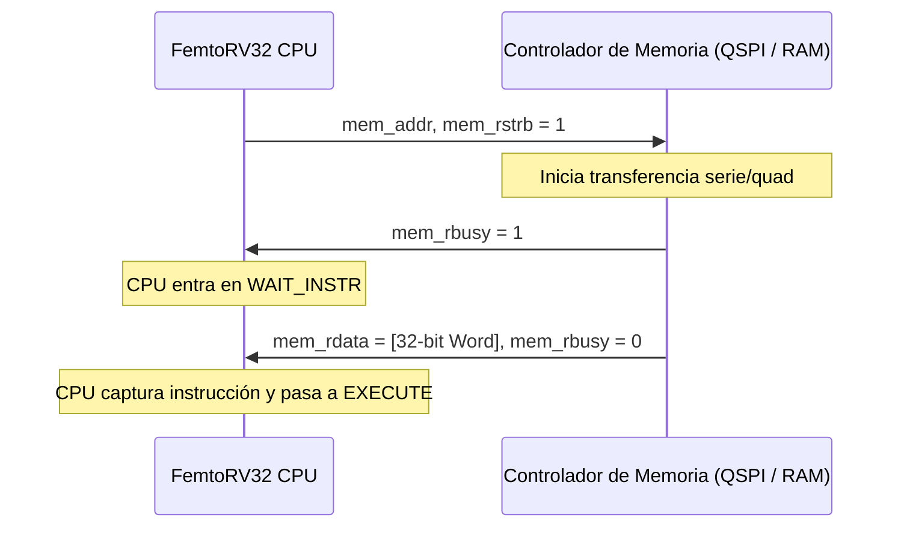

# Arquitectura y Microarquitectura del Procesador

Esta sección está dirigida a desarrolladores de hardware que deseen comprender la estructura interna del procesador **FemtoRV32 Quark**, su máquina de estados, el bus de memoria y el mecanismo de interrupciones para depuración o extensión de la arquitectura.

---

## 1. Visión General del Núcleo FemtoRV32 Quark

El núcleo procesador implementado en `femtorv32_quark_un_irq.v` es una variante minimalista de la arquitectura **RISC-V RV32I** con ejecución multietapa secuencial basada en una Máquina de Estados Finitos (FSM). A diferencia de los diseños superescalares o fuertemente segmentados (*pipelined*), FemtoRV32 prioriza la **densidad de silicio** y la **sencillez de control**, convirtiéndolo en un diseño idóneo para Tiny Tapeout y nodos limitados en área.



---

## 2. Máquina de Estados Finitos (FSM)

El ciclo de vida de cada instrucción consta de las siguientes fases:

| Estado | Señales Clave Activas | Operación Realizada |
| :--- | :--- | :--- |
| **`FETCH_INSTR`** | `mem_addr = PC`, `mem_rstrb = 1` | Solicita la lectura de los 4 bytes de instrucción desde la memoria Flash externa. |
| **`WAIT_INSTR`** | `mem_rstrb = 1` | Mantiene la solicitud mientras el controlador de memoria indique `mem_rbusy = 1`. Cuando `mem_rbusy` pasa a `0`, la instrucción entrante (`mem_rdata`) se almacena en el registro de instrucción (`instr`). |
| **`EXECUTE`** | Decodificación de campos `opcode`, `rd`, `rs1`, `rs2`, `funct3`, `funct7` | Decodifica la instrucción. Si es una operación ALU de registro o inmediata (ej. `ADDI`, `LUI`, `ADD`), calcula el resultado y escribe en el banco de registros en este mismo ciclo, pasando directamente a `FETCH_INSTR` del siguiente `PC`. |
| **`WAIT_ALU_OR_MEM`** | `mem_addr = rs1 + imm`, `mem_rstrb` o `mem_wmask` activo | Si la instrucción requiere acceso a memoria de datos (`LW`, `SW`) o cálculo multivariado lento (ej. multiplicación externa), la FSM aguarda la señal de finalización antes de retornar a `FETCH_INSTR`. |

---

## 3. Banco de Registros (*Register File*)

- **Tamaño**: 32 registros de propósito general de 32 bits (`x0` a `x31`).
- **Registro x0**: Cableado de forma permanente a cero lógico (`32'b0`). Cualquier escritura en `x0` se descarta de forma transparente.
- **Implementación**: Sintetizado como matriz de flip-flops con lógica de multiplexado para lectura asíncrona (`rs1` y `rs2`) y escritura síncrona en el flanco de subida de reloj (`posedge clk`).

---

## 4. Bus de Memoria y Protocolo de Handshake

El núcleo utiliza un bus unificado de memoria con interfaz tipo *ready-valid*:



### Señales del Bus de Memoria:
- `mem_addr[31:0]`: Dirección de 32 bits generada por el procesador.
- `mem_rdata[31:0]`: Datos de lectura entregados por el módulo direccionado.
- `mem_wdata[31:0]`: Datos de escritura provistos por el procesador.
- `mem_wmask[3:0]`: Máscara de bytes para escrituras parciales (`4'b0001` byte, `4'b0011` half-word, `4'b1111` word).
- `mem_rstrb`: Estrobo de lectura (activo en alto mientras se espera el dato).
- `mem_rbusy`: Señal de ocupado provista por el periférico/memoria activa.

---

## 5. Decodificación de Memoria Top-Level en `femto.v`

En `femto.v`, el decodificador de direcciones evalúa los bits más significativos de `mem_addr` para generar las señales de selección de chip (*Chip Selects*):

```verilog
wire is_flash = (mem_addr[31:16] == 16'h0000);  // 0x0000_0000 - 0x0000_FFFF
wire is_ram   = (mem_addr[31:16] == 16'h0001);  // 0x0001_0000 - 0x0001_FFFF
wire is_uart  = (mem_addr[31:16] == 16'h0040);  // 0x0040_0000
wire is_gpio  = (mem_addr[31:16] == 16'h0041);  // 0x0041_0000
wire is_mult  = (mem_addr[31:16] == 16'h0042);  // 0x0042_0000

// Multiplexado del bus de datos de lectura hacia la CPU
assign mem_rdata = is_flash ? qspi_rdata :
                   is_ram   ? ram_rdata  :
                   is_uart  ? uart_rdata :
                   is_mult  ? mult_rdata : 32'h00000000;

// Ocupado general hacia la CPU
assign mem_rbusy = (is_flash && qspi_rbusy) ||
                   (is_ram   && ram_rbusy)  ||
                   (is_mult  && mult_rbusy);
```

---

## 6. Sistema de Interrupciones

El procesador implementa interrupciones por hardware mediante el pin de entrada `ui_in[3]`. Cuando se detecta un flanco en la línea de interrupción:
1. El procesador almacena el `PC` actual en el registro `mepc`.
2. Salta al vector de interrupción predeterminado en memoria Flash.
3. Al finalizar la rutina de servicio a la interrupción (ISR), la instrucción `MRET` restaura el `PC` desde `mepc` y continúa la ejecución del hilo principal.
