# Controladores de Memoria: Quad-SPI vs SPI Serial y Análisis del Bug Físico

Esta sección técnica analiza a bajo nivel el diseño de los controladores de memoria serie del SoC, el diagnóstico del bug del silicio físico original (Tiny Tapeout SKY25b) y la implementación de la nueva interfaz Quad-SPI (`MappedQSPIFlash.v`).

---

## 1. El Controlador Original: `MappedSPIFlash.v` y el Bug del Corrimiento

### Principio de Operación Original
El módulo `MappedSPIFlash.v` opera en modo SPI de 1 bit utilizando el comando estándar de lectura `0x03`:
1. Activa `CS#` en nivel bajo.
2. Emite 8 ciclos de reloj para enviar el comando `0x03` por la línea MOSI.
3. Emite 24 ciclos de reloj para enviar la dirección de 24 bits.
4. Emite 32 ciclos de reloj para leer los 4 bytes de datos por la línea MISO.
5. Eleva `CS#` a nivel alto y baja `rbusy`.

### Diagnóstico del Bug del Silicio Físico
Al fabricarse el chip en silicio (*Tapeout*), se descubrió que el contador de pulsos de reloj generaba un pulso espurio adicional durante la transición de fin de dirección o inicio de datos (65 pulsos en vez de 64 pulsos).

```text
Reloj SPI Esperado:   _-_-_-_ ... (64 pulsos) -> Captura datos alineados
Reloj SPI en Silicio: _-_-_-_ ... (65 pulsos) -> Captura con 1 bit de retraso
```

**Efecto en los datos capturados**:
El valor recibido en el bus interno queda **desplazado 1 bit a la izquierda** ($Data_{recibido} = Data_{real} \ll 1$).

### La Solución por Software: `fix_shift.py`
Para que el silicio fabricado pueda ejecutar instrucciones sin requerir un nuevo chip, se desarrolló el script `fix_shift.py`, el cual pre-desplaza los bytes de instrucción 1 bit a la derecha antes de grabarlos en la memoria Flash:

```python
# fix_shift.py (fragmento esencial)
def pre_shift_instruction(word32):
    # Desplaza 1 bit a la derecha para compensar el corrimiento a la izquierda del silicio
    return (word32 >> 1) & 0x7FFFFFFF
```

!!! warning "Limitación del Shift por Software"
    Esta compensación es viable para instrucciones inmediatas y saltos relativos fijos, pero **invalida el bit más significativo (MSB)** de ciertas instrucciones (bit 31), lo que afecta campos de signo en inmediatos negativos y ciertas codificaciones de salto largo.

---

## 2. El Nuevo Controlador: `MappedQSPIFlash.v` (Hirosh Dabui / Lone Dynamics)

Para solucionar de raíz los problemas del silicio anterior y aumentar drásticamente el rendimiento, se integró el controlador **`MappedQSPIFlash.v`**, basado en el diseño `qqspi` adaptado a la interfaz de handshake de FemtoRV32.

```mermaid
sequenceDiagram
    autonumber
    participant Core as FemtoRV32
    participant QSPI as MappedQSPIFlash
    participant Bus as Pines uio (SIO[3:0])
    participant Flash as Chip Flash Externo

    Core->>QSPI: mem_rstrb = 1, word_address = PC[23:2]
    Note over QSPI: S0_IDLE -> S1_SELECT
    QSPI->>Bus: ce_flash_n = 0 (uio[0]=0)
    Note over QSPI: S2_CMD (Comando 0xEB Fast Read)
    QSPI->>Bus: SIO0 = 8 ciclos de comando (0xEB)
    Note over QSPI: S4_ADDR (Dirección de 24 bits)
    QSPI->>Bus: SIO[3:0] = 6 ciclos a 4 bits (uio_oe = 4'b1111)
    Note over QSPI: S5_WAIT (Dummy Cycles)
    QSPI->>Bus: 6 ciclos de espera (uio_oe = 4'b0000, Hi-Z)
    Note over QSPI: S6_XFER (Transferencia de Datos)
    Flash->>Bus: SIO[3:0] = 8 ciclos a 4 bits (32 bits de instrucción)
    Note over QSPI: S7_DONE: Conversión Little-Endian
    QSPI->>Core: mem_rdata = [Instrucción], mem_rbusy = 0
```



---

## 3. Máquina de Estados del Controlador QSPI

El controlador utiliza 7 estados totalmente síncronos sin generadores de pulso asíncronos:

```verilog
localparam [2:0] S0_IDLE               = 3'd0;
localparam [2:0] S1_SELECT_DEVICE     = 3'd1;
localparam [2:0] S2_CMD               = 3'd2;
localparam [2:0] S4_ADDR              = 3'd3;
localparam [2:0] S5_WAIT              = 3'd4;
localparam [2:0] S6_XFER              = 3'd5;
localparam [2:0] S7_WAIT_FOR_XFER_DONE = 3'd6;
```

### Detalles de Cada Fase:
1. **`S0_IDLE`**: Pines en alta impedancia; espera señal `valid` (`rstrb`).
2. **`S1_SELECT_DEVICE`**: Activa la línea de selección de chip (`ce_ctrl` invertido hacia `ce_flash_n`).
3. **`S2_CMD`**: Envía el byte de comando `0xEB` (*Fast Read Quad*) mediante `SIO0` a 1 bit.
4. **`S4_ADDR`**: Envía los 24 bits de dirección del bus emitiendo **4 bits por ciclo** en `SIO[3:0]` (tarda solo 6 ciclos de reloj SPI en lugar de 24).
5. **`S5_WAIT`**: Configura `uio_oe = 4'b0000` (alta impedancia) y aguarda 6 ciclos de reloj SPI *dummy* requeridos por la Flash antes de entregar los datos.
6. **`S6_XFER`**: Muestrea `SIO[3:0]` en el flanco ascendente de `sclk`. En 8 ciclos de reloj SPI se leen los 32 bits completos de la instrucción.
7. **`S7_WAIT_FOR_XFER_DONE`**: Realiza el reordenamiento de bytes de Big-Endian a Little-Endian nativo de RISC-V:
   ```verilog
   rdata_next = {spi_buf[7:0], spi_buf[15:8], spi_buf[23:16], spi_buf[31:24]};
   ```
   Eleva `ready_next = 1'b1`, desactiva `rbusy` y retorna a `S0_IDLE`.

---

## 4. Alineación y Escritura en Memoria RAM (`align_wdata`)

Para operaciones de almacenamiento en RAM (`SB`, `SH`, `SW`), el submódulo `align_wdata` inspecciona la máscara `wstrb` (equivalente a `mem_wmask`):

| `wstrb` | Tipo de Escritura | Desplazamiento (`byte_offset`) | Ciclos de Escritura (`wr_cycles`) |
| :---: | :--- | :---: | :---: |
| `4'b0001` | Byte 0 (`SB`) | 3 | 8 ciclos SPI |
| `4'b0010` | Byte 1 (`SB`) | 2 | 8 ciclos SPI |
| `4'b0100` | Byte 2 (`SB`) | 1 | 8 ciclos SPI |
| `4'b1000` | Byte 3 (`SB`) | 0 | 8 ciclos SPI |
| `4'b0011` | Half-Word inferior (`SH`) | 2 | 16 ciclos SPI |
| `4'b1100` | Half-Word superior (`SH`) | 0 | 16 ciclos SPI |
| `4'b1111` | Word completa de 32 bits (`SW`) | 0 | 32 ciclos SPI |

Esta adaptación permite que memorias RAM SPI externas se comporten lógicamente como una memoria de 32 bits con acceso granular por bytes.
