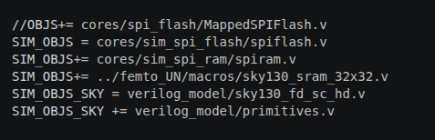
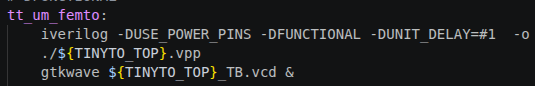
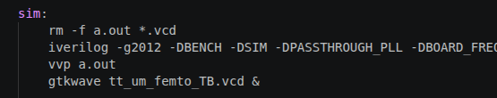
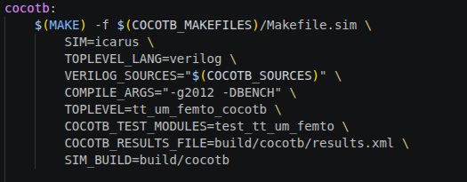

## 4. Integración en el SoC (`femto_UN/src/femto.v`)

La integración se lleva a cabo en el archivo top-level del SoC `femto.v`, conectando la memoria directamente al bus del procesador `FemtoRV32 Quark` sin alterar los módulos de periféricos existentes.

### 4.1 Mapeo de Direcciones (Memory Map)

Se habilita la línea de selección `cs[4]` (`7'b0010000`) en el rango base `0x00410000` (128 bytes, desde `0x00410000` hasta `0x0041007F`):

```verilog hl_lines="7"
  // Decodificador de direcciones
  always @*
  begin
      case (mem_address)
        16'h0000: cs = 7'b0000001;  // Flash SPI (Programa)
        16'h0040: cs = 7'b0100000;  // UART
        16'h0041: cs = 7'b0010000;  // OpenRAM Interna (32x32, 128 bytes)
        16'h0001: cs = 7'b1000000;  // SPI RAM externa
        default:  cs = 7'b0000001;
      endcase
  end
```

### 4.2 Instanciación del Macro y Handshake

```verilog hl_lines="19-39"
   MappedSPIFlash mapped_spi_flash(
      .clk(clk),
      .reset(resetn),
      .rstrb(cs[0] & rd),
      .word_address(mem_address[21:2]),
      .rdata(RAM_rdata),
      .rbusy(mapped_spi_flash_rbusy),
      .CLK(spi_clk),
      .CS_N(spi_cs_n),
      .MISO(spi_miso),
      .MOSI(spi_mosi)
   );

   wire [31:0] uart_dout;
   // wire [31:0] dpram_dout;
   // ============== OpenRAM Internal SRAM (32x32) ========================

   wire [32:0] sram_dout_raw;
   wire [31:0] sram_dout = sram_dout_raw[31:0];
   wire sram_cs  = (mem_address == 16'h0041);
   wire sram_csb = ~(sram_cs & (mem_rstrb | wr));
   wire sram_web = ~(sram_cs & wr);

   sky130_sram_32x32 u_sram (
`ifdef USE_POWER_PINS
      .vccd1(1'b1),
      .vssd1(1'b0),
`endif
      .clk0(clk),
      .csb0(sram_csb),
      .web0(sram_web),
      .wmask0(mem_wmask),
      .spare_wen0(1'b0),
      .addr0(mem_address[6:2]),
      .din0({1'b0, mem_wdata[31:0]}),
      .dout0(sram_dout_raw)
   );
```


### 4.3 Multiplexor de Lectura de Datos (`mem_rdata`)

Al poseer un ancho nativo de 32 bits, la salida de la OpenRAM se conecta de forma directa al bus de lectura `mem_rdata` sin requerir alineaciones ni ceros adicionales:

```verilog
  always @*
  begin
      case (cs)
        7'b1000000: mem_rdata = dpram_dout;
        7'b0100000: mem_rdata = uart_dout;
        7'b0010000: mem_rdata = sram_dout; // Lectura OpenRAM directa (32 bits)
        7'b0000001: mem_rdata = RAM_rdata;
        default:    mem_rdata = 32'h00000000;
      endcase
  end
```

??? note "Análisis de Señales de Control y Puertos"
    * **`addr0` (`mem_address[6:2]`):** Se toman 5 bits (`[6:2]`) para indexar las **32 palabras** ($2^5 = 32$). Las direcciones efectivas avanzan de 4 en 4 bytes (`0x00410000`, `0x00410004`, ..., `0x0041007C`), cubriendo los 128 bytes asignados.
    * **`wmask0[3:0]` (`mem_wmask[3:0]`):** Conexión 1 a 1 de la máscara de bytes generada por el núcleo FemtoRV32, permitiendo escrituras selectivas a nivel de byte (`sb`), media palabra (`sh`) o palabra completa (`sw`).
    * **`din0` (`{1'b0, mem_wdata[31:0]}`):** Los 32 bits útiles de datos se transfieren directamente desde `mem_wdata`, fijando el bit 32 de la columna de reserva en `1'b0`.
    * **`spare_wen0` (`1'b0`):** Deshabilita de forma permanente la escritura en la columna de reserva de Sky130.
    * **`csb0` y `web0`:** Señales de habilitación activas en bajo (*active-low*). En lectura (`sram_cs & mem_rstrb`), `csb0=0` y `web0=1`. En escritura (`sram_cs & wr`), `csb0=0` y `web0=0`.

??? important "Temporización del Procesador FemtoRV32 Quark y Wait-States"
    El núcleo FemtoRV32 Quark implementa la siguiente condición para transicionar de estado:
    ```verilog
    wire needToWait = isLoad | isStore | (isALU & funct3IsShift);
    ```
    Esto significa que el procesador **siempre** entra al estado `WAIT_ALU_OR_MEM` durante exactamente 1 ciclo de reloj en toda instrucción de lectura (`isLoad`) y escritura (`isStore`):
    
    1. **Ciclo `EXECUTE`:** El procesador evalúa la dirección efectiva (`loadstore_addr`), activa `mem_rstrb = 1` y selecciona el macro (`csb0 = 0`, `web0 = 1`). En el flanco positivo de reloj que cierra este ciclo, OpenRAM muestrea la dirección.
    2. **Ciclo `WAIT_ALU_OR_MEM`:** Durante este ciclo, OpenRAM entrega el dato leído en `dout0`. En el siguiente flanco de reloj de subida, el banco de registros captura `writeBackData` y el procesador avanza a `FETCH_INSTR`.
    
    Por lo tanto, **no se requiere ninguna señal artificial `sram_rbusy`**. Si se agregara un `rbusy` de 1 ciclo adicional, se forzaría al procesador a esperar 2 ciclos en `WAIT_ALU_OR_MEM`, provocando que el modelo OpenRAM invalide la salida a `'x'` al deseleccionarse `csb0`.

---

## 5. Configuración de OpenLane (`config.json`)

En `femto_UN/src/config.json`, se actualizan las directivas para la inclusión del macro 32x32, colocación estática y conexión de redes de potencia:

```json
  "//": "OpenRAM Hard Macro Configuration",
  "MACROS": {
    "sky130_sram_32x32": {
      "gds": ["dir::../macros/sky130_sram_32x32.gds"],
      "lef": ["dir::../macros/sky130_sram_32x32.lef"],
      "instances": {
        "femto0.u_sram": {
          "location": [15, 30],
          "orientation": "N"
        }
      },
      "nl": ["dir::../macros/sky130_sram_32x32.v"]
    }
  },
  "EXTRA_LEFS": ["dir::../macros/sky130_sram_32x32.lef"],
  "EXTRA_GDS_FILES": ["dir::../macros/sky130_sram_32x32.gds"],
  "EXTRA_LIBS": ["dir::../macros/sky130_sram_32x32_TT_1p8V_25C.lib"],
  "PDN_MACRO_CONNECTIONS": [
    "femto0.u_sram vccd1 vssd1 vccd1 vssd1"
  ]
```

---
- <a href="../../../assets/openram/config.json" target="_blank" rel="noopener">Abrir archivo JSON en pestaña nueva</a>


### 5.1 Ubicación Física (Floorplan)

Se define la ubicación en el archivo `config.json` de OpenLane en las coordenadas:

* **Posición:** `[15.0, 30.0]` $\mu\text{m}$
* **Orientación:** `N` (Normal)
* **Ocupación espacial:**
    * **Eje $X$:** de $15.0\,\mu\text{m}$ a $325.68\,\mu\text{m}$ ($310.68\,\mu\text{m}$ de ancho).
    * **Eje $Y$:** de $30.0\,\mu\text{m}$ a $190.44\,\mu\text{m}$ ($160.44\,\mu\text{m}$ de alto).

Esta colocación optimiza la distribución en el die de 4x2 tiles, ubicando el macro en la parte izquierda y dejando $94,442\,\mu\text{m}^2$ ($65.5\%$) libres en la región central y derecha para el enrutamiento y las celdas estándar de la CPU y periféricos.

---

## 6. Configuración de Tiny Tapeout (`info.yaml`)

Se agrega el modelo *blackbox* a la lista de fuentes compilables por OpenLane dentro de `info.yaml`:

```yaml
  # How many tiles your design occupies?
  tiles: "4x2"

  top_module:  "tt_um_femto"

  source_files:
    - "femto.v"
    - "MappedSPIRAM.v"
    - "MappedSPIFlash.v"
    - "perip_uart.v"
    - "uart.v"
    - "femtorv32_quark_un_irq.v"
    - "sky130_sram_32x32_bb.v"
```

---

## 7 Cambio del Makefile en la carpeta tinytapeout.
Para que tanto la simulación RTL estándar (`make sim` con Icarus Verilog + GTKWave) como la verificación funcional (`make cocotb`) integren el modelo de la memoria interna **OpenRAM (`sky130_sram_32x32`)**, se realizaron los siguientes cambios sobre `tinytapeout/Makefile` (conservando respaldo previo en `Makefile.bak`):

- **Inclusión del modelo Verilog de la SRAM:** Se añadió la ruta al archivo fuente `sky130_sram_32x32.v` dentro de la variable de fuentes (`VERILOG_SOURCES`).



- **Definición de macros de simulación:** Se incorporaron las directivas necesarias (como `-Dfunctional` o `-DUSE_POWER_PINS` según la celda) para evitar errores de puertos de alimentación (`vccd1` / `vssd1`) durante la simulación lógica.


- **Unificación de dependencias:** Tanto el target `sim` como `cocotb` apuntan ahora a la misma lista de fuentes y rutas.




### 7.1 Integracion del cocotb
Para integrar la verificación funcional mediante **Cocotb**, se añadieron en `tinytapeout/Makefile` las rutas de configuración del entorno (`COCOTB_MAKEFILES`), la lista unificada de fuentes con el *wrapper* y el modelo funcional de la memoria (`COCOTB_SOURCES`), y los objetivos de simulación (`cocotb` y `cocotb_openram`) configurados con **Icarus Verilog**:

```makefile
COCOTB_MAKEFILES := $(shell cocotb-config --makefiles)
COCOTB_SOURCES   := $(abspath tt_um_femto_cocotb.v $(OBJS) ../femto_UN/macros/sky130_sram_32x32.v)

cocotb:
	$(MAKE) -f$(COCOTB_MAKEFILES)/Makefile.sim \
		SIM=icarus \
		TOPLEVEL_LANG=verilog \
		VERILOG_SOURCES="$(COCOTB_SOURCES)" \
		COMPILE_ARGS="-g2012 -DBENCH" \
		TOPLEVEL=tt_um_femto_cocotb \
		COCOTB_TEST_MODULES=test_tt_um_femto \
		COCOTB_RESULTS_FILE=build/cocotb/results.xml \
		SIM_BUILD=build/cocotb

cocotb_openram:
	$(MAKE) -f$(COCOTB_MAKEFILES)/Makefile.sim \
		SIM=icarus \
		TOPLEVEL_LANG=verilog \
		VERILOG_SOURCES="$(COCOTB_SOURCES)" \
		COMPILE_ARGS="-g2012 -DBENCH" \
		TOPLEVEL=tt_um_femto_cocotb \
		MODULE=test_tt_um_femto_openram \
		COCOTB_TEST_MODULES=test_tt_um_femto_openram \
		COCOTB_RESULTS_FILE=build/cocotb_openram/results.xml \
		SIM_BUILD=build/cocotb_openram
```

??? example "Ver `tinytapeout/Makefile` completo (Clic para expandir)"
    ```makefile linenums="1"
    --8<-- "assets/tinytapeout/Makefile"
    ```
