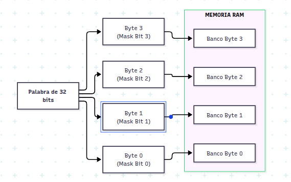

!!! info "Repositorio del Proyecto"
    El código fuente del SoC, el macro generado con OpenRAM y el entorno de verificación en Cocotb están disponibles temporalmente en este repositorio:

    * **Repositorio completo:** [github.com/exteruz/asic-openRam](https://github.com/exteruz/asic-openRam)
    * **Macro OpenRAM (`.lef`, `.lib`, `.gds`, `.v`):** [`femto_UN/macros/`](https://github.com/exteruz/asic-openRam/tree/main/femto_UN/macros)
    * **Testbench Cocotb y `Makefile`:** [`tinytapeout/`](https://github.com/exteruz/asic-openRam/tree/main/tinytapeout)

# Creacion de la memoria usando OpenRam

Este apartado describe el proceso de creación del macro de memoria RAM estática síncrona (**OpenRAM 32×32**, 32 palabras de 32 bits = 128 bytes) a través de **OpenRAM** sobre la tecnología SkyWater 130nm (Sky130A), con máscara de escritura por byte (`wmask0[3:0]`), dimensionado para el SoC **femto_UN** dentro del presupuesto de área de **4×2 tiles** de Tiny Tapeout.


## 2. Generación del Macro OpenRAM (`sky130_sram_32x32`)

El macro se compila con el generador de memorias OpenRAM configurado para la tecnología SkyWater 130nm.

### 2.1 Archivo de Configuración (`sram_32x32_config.py`)

```python
# Capacidad: 32 palabras x 32 bits (128 bytes)
word_size = 32              # Ancho de palabra: 32 bits (4 bytes)
num_words = 32              # Profundidad: 32 palabras (5 bits de dirección)
write_size = 8              # Granularidad de escritura: genera el pin wmask0[3:0]

num_rw_ports = 1            # 1 puerto de lectura/escritura síncrono (1RW)
num_r_ports = 0
num_w_ports = 0
words_per_row = 1

# Requerido en Sky130 para simetría par en columnas de sensado
num_spare_cols = 1

tech_name = "sky130A"

# Opciones de compilación física
nominal_corner_only = True
analytical_delay = True
route_supplies = "ring"
check_lvsdrc = True

output_name = "sky130_sram_32x32"
output_path = "macro_32x32"
```

Granularidad de escritura



??? note "Por qué se incluye `num_spare_cols = 1` y Máscara de Escritura (`write_size = 8`)"
    1. **Máscara de Byte (`wmask0[3:0]`):** Con `write_size = 8` y `word_size = 32`, OpenRAM divide la fila en 4 campos independientes de 8 bits. La señal `wmask0[0]` controla los bits `[7:0]`, `wmask0[1]` los bits `[15:8]`, `wmask0[2]` los bits `[23:16]` y `wmask0[3]` los bits `[31:24]`. Esto permite que el procesador RISC-V ejecute instrucciones `sb` (*store byte*) y `sh` (*store halfword*) directamente sin destruir los bytes adyacentes de la palabra.
    2. **Bus de 33 bits y Columna de Reserva (`num_spare_cols = 1`):** En SkyWater 130nm, la celda SRAM de 6 transistores (`sky130_fd_bd_sram__sram_sp_cell_opt1`) requiere restricciones de simetría física y paridad en los amplificadores de sentido (*sense amplifiers*). OpenRAM exige `num_spare_cols = 1`, generando un bus de 33 bits (`din0[32:0]`, `dout0[32:0]`) y una señal `spare_wen0`. En el hardware, los 32 bits útiles se conectan al bus de datos y el bit 32 se fija a `0` con `spare_wen0 = 1'b0`.

### 2.2 Archivos del Macro Producidos

Los archivos resultantes se alojan en el directorio `femto_UN/macros/`:
* `sky130_sram_32x32.gds`: Layout físico GDSII.

* `sky130_sram_32x32.lef`: Información abstracta de geometría y pines para Place & Route (PnR).
* `sky130_sram_32x32_TT_1p8V_25C.lib`: Modelo de tiempos y potencia Liberty (*timing corner* típico 1.8V, 25°C).
* `sky130_sram_32x32.v`: Modelo funcional de simulación Verilog.
* `sky130_sram_32x32.sp`: Netlist SPICE con transistores extraídos para LVS.

---

??? info "Datasheet OpenRAM: sky130_sram_32x32 (Clic para expandir)"
    <iframe src="../../../assets/openram/sky130_sram_32x32.html" width="100%" height="700px" style="border: none;"></iframe>
* [Descargar archivo LEF (sky130_sram_32x32.lef)](../../assets/openram/sky130_sram_32x32.lef)


## 3. Modelo Blackbox Verilog (`sky130_sram_32x32_bb.v`)

Para que Yosys reconozca el macro como un bloque pre-sintetizado durante la síntesis lógica sin inferir compuertas internas, se define el *blackbox* respetando la totalidad de pines del archivo LEF:

```verilog
/* verilator lint_off UNUSED */
module sky130_sram_32x32 (
`ifdef USE_POWER_PINS
    inout  wire        vccd1,
    inout  wire        vssd1,
`endif
    input  wire        clk0,
    input  wire        csb0,
    input  wire        web0,
    input  wire [3:0]  wmask0,
    input  wire        spare_wen0,
    input  wire [4:0]  addr0,
    input  wire [32:0] din0,
    output wire [32:0] dout0
);
endmodule
/* verilator lint_on UNUSED */
```

El archivo se almacena en `femto_UN/macros/sky130_sram_32x32_bb.v` y en `femto_UN/src/sky130_sram_32x32_bb.v`.

---


## 4. Resumen de Archivos Generados

| Archivo | Ruta | Descripción |
| :--- | :--- | :--- |
| `sram_32x32_config.py` | `open_ram/OpenRAM/` | Script de configuración para el compilador OpenRAM. |
| `sky130_sram_32x32.gds` | `femto_UN/macros/` | Layout físico GDSII del macro ($310.68\ \mu\text{m} \times 160.44\ \mu\text{m}$). |
| `sky130_sram_32x32.lef` | `femto_UN/macros/` | Definición abstracta LEF (geometría y pines para PnR). |
| `sky130_sram_32x32_TT_1p8V_25C.lib` | `femto_UN/macros/` | Modelo de tiempos y potencia Liberty (`1.8 V`, `25 °C`). |
| `sky130_sram_32x32.v` | `femto_UN/macros/` | Modelo funcional Verilog para simulación síncrona. |
| `sky130_sram_32x32.sp` | `femto_UN/macros/` | Netlist SPICE con transistores extraídos para LVS. |
| `sky130_sram_32x32_bb.v` | `femto_UN/macros/` y `femto_UN/src/` | Módulo Blackbox para síntesis lógica con Yosys. |