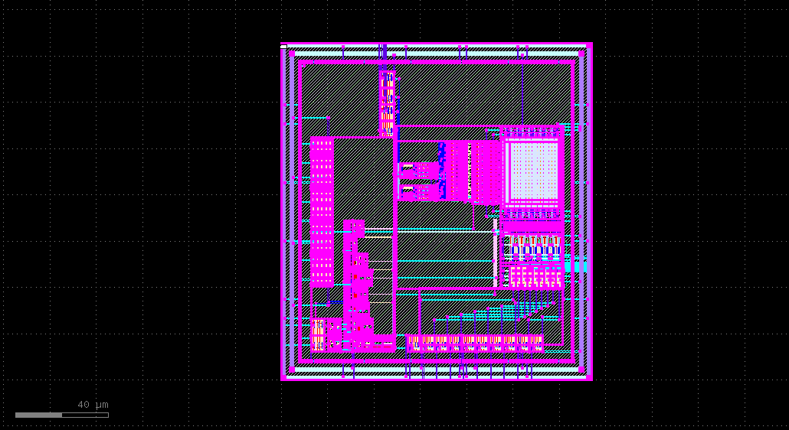

!!! info "Repositorio del Proyecto"
    El código fuente del SoC, el macro generado con OpenRAM y el entorno de verificación en Cocotb están disponibles en el repositorio oficial del proyecto:

    * **Repositorio completo:** [github.com/exteruz/asic-openRam](https://github.com/exteruz/asic-openRam)
    * **Macro OpenRAM (`.lef`, `.lib`, `.gds`, `.v`):** [`femto_UN/macros/`](https://github.com/exteruz/asic-openRam/tree/main/femto_UN/macros)
    * **Testbench Cocotb y `Makefile`:** [`tinytapeout/`](https://github.com/exteruz/asic-openRam/tree/main/tinytapeout)

# Creacion de la memoria usando OpenRam

Este apartado describe el proceso de creación del macro de memoria RAM estática síncrona (**OpenRAM 16×8**, 16 palabras de 8 bits = 16 bytes) a través de **OpenRAM** sobre la tecnología SkyWater 130nm, dimensionado para el SoC **femto_UN** dentro del presupuesto de área de **4×2 tiles** de Tiny Tapeout.


## 1 Análisis de Área en `4x2` Tiles

El bloque asignado de **`4x2` tiles** en Tiny Tapeout ofrece un área total de **$154,095\ \mu\text{m}^2$** ($682.56\ \mu\text{m} \times 225.76\ \mu\text{m}$, equivalente a 8 *tiles*).

* **Diseño anterior (`femto_UN` sin RAM):** El procesador RISC-V y sus periféricos ocupaban cerca de **$74,000\ \mu\text{m}^2$** 
* **Diseño nuevo (`femto_UN` + OpenRAM `16x8`):** El macro `sky130_sram_16x8` (con su margen de aislamiento) suma aproximadamente **$22,000\ \mu\text{m}^2$** 

Al integrarlos, el diseño completo ocupa cerca del **$62.3\%$** del área ($96,000\ \mu\text{m}^2$ o **5.3 *tiles***), conservando un **$37.7\%$ de espacio libre** para enrutamiento y síntesis de reloj (*CTS*), por lo que cabe sin ampliar los `4x2` tiles.


## 2. Generación del Macro OpenRAM (`sky130_sram_16x8`)

El macro se compila con el generador de memorias OpenRAM configurado para la tecnología Sky130.

### 2.1 Archivo de Configuración (`sram_16x8_config.py`)

```python
word_size = 8               # Ancho de palabra útil: 8 bits (1 byte)
num_words = 16              # Profundidad: 16 palabras (4 bits de dirección)
num_rw_ports = 1            # 1 puerto síncrono lectura/escritura (1RW)
num_r_ports = 0
num_w_ports = 0

tech_name = "sky130"
process_corners = ["TT"]
supply_voltages = [1.8]
temperatures = [25]

nominal_corner_only = True
route_supplies = True
check_lvsdrc = True

# Parámetro crítico para simetría Sky130
num_spare_cols = 1
```

??? note "Por qué se incluye `num_spare_cols = 1` (Columna de Reserva)"
    En SkyWater 130nm, la celda de memoria SRAM de 6 transistores (`sky130_fd_bd_sram__sram_sp_cell_opt1`) requiere restricciones de pitch de columna y simetría en los amplificadores de sentido (*sense amplifiers*). OpenRAM exige `num_spare_cols = 1`, lo que genera un bus interno de **9 bits** (`din0[8:0]`, `dout0[8:0]`) y una señal de control `spare_wen0`. En el hardware, los 8 bits útiles se conectan al bus de datos del procesador y el noveno bit se fija a `0` para garantizar compatibilidad eléctrica y dimensional.

### 2.2 Archivos del Macro Producidos

Los archivos resultantes se alojan en el directorio `femto_UN/macros/`:
* `sky130_sram_16x8.gds`: Layout físico GDSII.

* `sky130_sram_16x8.lef`: Información abstracta de geometría y pines para Place & Route (PnR).
* `sky130_sram_16x8_TT_1p8V_25C.lib`: Modelo de tiempos y potencia Liberty (*timing corner* típico 1.8V, 25°C).
* `sky130_sram_16x8.v`: Modelo funcional de simulación Verilog.

---

??? info "Datasheet OpenRAM: sky130_sram_16x8 (Clic para expandir)"
    <iframe src="../../../assets/openram/sky130_sram_16x8.html" width="100%" height="700px" style="border: none;"></iframe>
* [Descargar archivo LEF (sky130_sram_16x8.lef)](../../assets/openram/sky130_sram_16x8.lef)


## 3. Modelo Blackbox Verilog (`sky130_sram_16x8_bb.v`)

Para que Yosys reconozca el macro como un bloque pre-sintetizado durante la síntesis lógica sin inferir compuertas internas, se define el *blackbox* respetando la totalidad de pines del archivo LEF:

```verilog
/* verilator lint_off UNUSED */
module sky130_sram_16x8 (
`ifdef USE_POWER_PINS
    inout  wire       vccd1,
    inout  wire       vssd1,
`endif
    input  wire       clk0,
    input  wire       csb0,
    input  wire       web0,
    input  wire       spare_wen0,
    input  wire [3:0] addr0,
    input  wire [8:0] din0,
    output wire [8:0] dout0
);
endmodule
/* verilator lint_on UNUSED */
```

El archivo se almacena en `femto_UN/macros/sky130_sram_16x8_bb.v` y en `femto_UN/src/sky130_sram_16x8_bb.v`.

---


## 3. Resumen de Archivos Generados

| Archivo | Ruta | Descripción |
| :--- | :--- | :--- |
| `sram_16x8_config.py` | `asic_ram/VLSI/` | Script de configuración para el compilador OpenRAM. |
| `sky130_sram_16x8.gds` | `femto_UN/macros/` | Layout físico GDSII del macro. |
| `sky130_sram_16x8.lef` | `femto_UN/macros/` | Definición abstracta LEF (geometría y pines para PnR). |
| `sky130_sram_16x8_TT_1p8V_25C.lib` | `femto_UN/macros/` | Modelo de tiempos y potencia Liberty (`1.8 V`, `25 °C`). |
| `sky130_sram_16x8.v` | `femto_UN/macros/` | Modelo funcional Verilog para simulación. |
| `sky130_sram_16x8_bb.v` | `femto_UN/macros/` y `femto_UN/src/` | Módulo Blackbox para síntesis lógica con Yosys. |