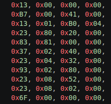
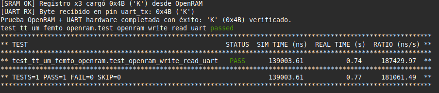
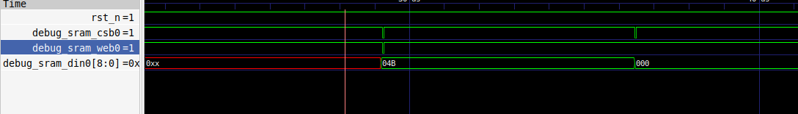
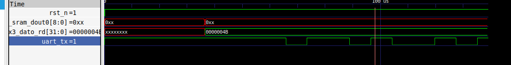

### SIMULACION 

Esta simulación verifica que la memoria OpenRAM funcione correctamente integrada con el procesador RISC-V y el puerto serie (UART) del sistema. Para lograrlo, el entorno de prueba emula una memoria Flash externa que le entrega al procesador un programa de verificación; al ejecutarse, el procesador escribe el carácter 'K' (0x4B) en la memoria OpenRAM, lo lee de vuelta para comprobar que el dato se almacenó sin errores y finalmente lo envía hacia el exterior por el pin de transmisión UART.


## Funcionamiento del Testbench en Cocotb

La verificación funcional se implementa en Python mediante **Cocotb** (`test_tt_um_femto_openram.py`) sobre el *wrapper* `tt_um_femto_cocotb`. A diferencia de un *testbench* tradicional en Verilog, Cocotb permite coordinar tareas concurrentes (*corutinas*) que interactúan con los pines del SoC en tiempo real.

El flujo de ejecución del código de prueba se divide en cuatro etapas:

1. **Generación de reloj y secuencia de reset:** Cocotb instancia un generador de reloj (`Clock`) sobre la entrada `clk`, habilita el bloque de Tiny Tapeout (`ena = 1`) y mantiene `rst_n = 0` durante los ciclos iniciales para llevar los registros internos y la máquina de estados a un estado conocido antes de liberar el procesador.
2. **Emulación concurrente de la SPI Flash:** Como el núcleo **FemtoRV32** arranca leyendo instrucciones desde una memoria externa, el script lanza una corutina en segundo plano (`cocotb.start_soon`) que escucha el bus SPI (`CS_n`, `SCK`, `MOSI`). Al detectar el comando de lectura (`0x03`) y la dirección de memoria, Python inyecta bit a bit por `MISO` el arreglo hexadecimal del programa de prueba.
3. **Interacción con la OpenRAM y periféricos:** Conforme el procesador ejecuta las instrucciones entregadas por la Flash emulada, escribe el carácter `'K'` (`0x4B`) en la dirección base de la memoria interna (`0x00410000`), lo lee de vuelta al registro `x3` y ordena su envío por el periférico **UART** (`0x00400000`).
4. **Decodificador UART y validación automática (`assert`):** En paralelo, una segunda corutina monitorea el pin de transmisión serie (`uart_tx`). Al detectar el flanco de bajada del bit de inicio (*start bit*), muestrea los 8 bits siguientes a la tasa de baudios configurada, reconstruye el byte recibido y ejecuta una comprobación automática (`assert`) verificando que el dato transmitido sea exactamente `'K'` (`0x4B`).


 


??? example "Ver código del Testbench Cocotb (`test_tt_um_femto_openram.py`)"

    ```python
    --8<-- "assets/openram/test_tt_um_femto_openram.py"
    ```

### Codigo ensamblador


```asm
_start:
    nop                     # Espera inicial tras reset

    # 1. Escritura y lectura en OpenRAM (0x00410000)
    lui  x1, 0x00410        # x1 = 0x00410000 (Base OpenRAM)
    li   x2, 0x4B           # x2 = 'K'
    sb   x2, 0(x1)          # OpenRAM[0] = 'K'
    lb   x3, 0(x1)          # x3 = OpenRAM[0]

    # 2. Transmisión del dato por UART (0x00400000)
    lui  x4, 0x00400        # x4 = 0x00400000 (Base UART)
    sb   x3, 8(x4)          # Cargar 'K' en registro de datos TX
    li   x5, 0x08           # Máscara bit 3 (tx_wr)
    sb   x5, 16(x4)         # Iniciar transmisión (tx_wr = 1)
    sb   x0, 16(x4)         # Limpiar pulso (tx_wr = 0)

loop:
    jal  x0, 0              # Detener ejecución
```


??? info "Ver tabla hexadecimal del firmware"
    | Dirección | Bytes Hex (Little-Endian) | Instrucción RISC-V | Operación |
    | :--- | :--- | :--- | :--- |
    | `0x00` | `0x13, 0x00, 0x00, 0x00` | `nop` | Espera inicial tras reset |
    | `0x04` | `0xB7, 0x00, 0x41, 0x00` | `lui x1, 0x00410` | `x1 = 0x00410000` (Base OpenRAM) |
    | `0x08` | `0x13, 0x01, 0xB0, 0x04` | `li x2, 0x4B` | `x2 = 0x4B` (`'K'`) |
    | `0x0C` | `0x23, 0x80, 0x20, 0x00` | `sb x2, 0(x1)` | Escribe `'K'` en `OpenRAM[0]` |
    | `0x10` | `0x83, 0x81, 0x00, 0x00` | `lb x3, 0(x1)` | Lee `OpenRAM[0]` hacia `x3` |
    | `0x14` | `0x37, 0x02, 0x40, 0x00` | `lui x4, 0x00400` | `x4 = 0x00400000` (Base UART) |
    | `0x18` | `0x23, 0x04, 0x32, 0x00` | `sb x3, 8(x4)` | Carga `'K'` en `d_in_uart` (`0x00400008`) |
    | `0x1C` | `0x93, 0x02, 0x80, 0x00` | `li x5, 0x08` | `x5 = 0x08` (Bit 3 = `tx_wr`) |
    | `0x20` | `0x23, 0x08, 0x52, 0x00` | `sb x5, 16(x4)` | Activa `tx_wr = 1` en `uart_ctrl` |
    | `0x24` | `0x23, 0x08, 0x02, 0x00` | `sb x0, 16(x4)` | Limpia `tx_wr = 0` en `uart_ctrl` |
    | `0x28` | `0x6F, 0x00, 0x00, 0x00` | `jal x0, 0` | Bucle infinito (`loop: j loop`) |


??? note "Ver Codigo"
    


??? note "Ver diagrama de flujo"
    


### Resultado de la Simulación

Al ejecutar la simulacion da el siguiente resultado:


    



### Verificacion Grafica de la simulacion.

1. **Ejecución completa:** Verificar que `debug_pc[23:0]` inicia en `000000` y se detiene en `000028`.

    

2. **Escritura en OpenRAM:** Verificar en `29.2 µs` que `csb0 = 0`, `web0 = 0`, `addr0 = 0` y `din0 = 04B`.

    

3. **Lectura desde OpenRAM:** Verificar en `36.4 µs` que `web0 = 1`, `dout0 = X4B` y `debug_x3_dato_rd = 0000004B`.

    

4. **Transmisión UART:** Verificar entre `43 µs` y `139 µs` el envío serie del carácter `'K'` (`0x4B`) por `uart_tx`.

    


---
