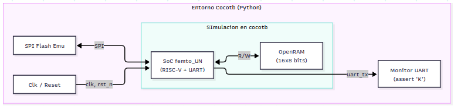
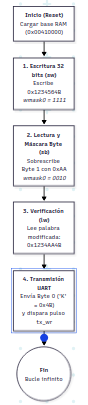
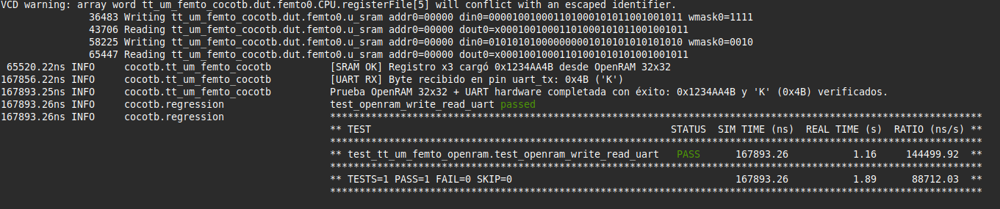
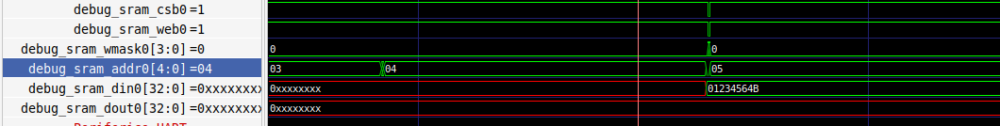
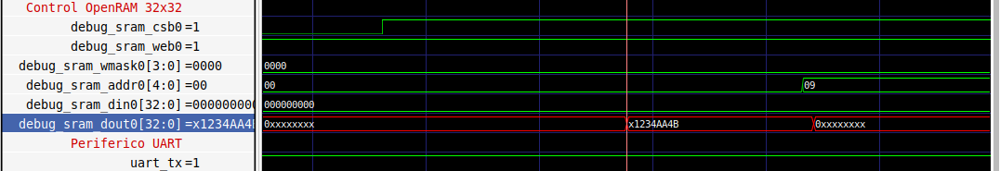

### SIMULACION 

Esta simulación verifica que la memoria OpenRAM 32×32 funcione correctamente integrada con el procesador RISC-V FemtoRV32 Quark y el puerto serie (UART) del sistema. Para lograrlo, el entorno de prueba emula una memoria Flash externa que entrega al procesador un firmware de verificación; al ejecutarse, el procesador escribe una palabra completa de 32 bits (`0x1234564B`) en la OpenRAM, realiza una escritura selectiva por máscara de byte (`0xAA` en el byte 1 con `wmask0 = 4'b0010`), lee el dato resultante (`0x1234AA4B`) para comprobar que el almacenamiento y la máscara funcionaron sin errores, y finalmente transmite el byte 0 (el carácter `'K'`, `0x4B`) hacia el exterior mediante el pin UART.


## Funcionamiento del Testbench en Cocotb

La verificación funcional se implementa en Python mediante **Cocotb** (`test_tt_um_femto_openram.py`) sobre el *wrapper* `tt_um_femto_cocotb`. A diferencia de un *testbench* tradicional en Verilog, Cocotb permite coordinar tareas concurrentes (*corutinas*) que interactúan con los pines del SoC en tiempo real.

El flujo de ejecución del código de prueba se divide en cuatro etapas:

1. **Generación de reloj y secuencia de reset:** Cocotb instancia un generador de reloj (`Clock`) sobre la entrada `clk` a ~27 MHz (periodo de 37038 ps), habilita el bloque de Tiny Tapeout (`ena = 1`) y mantiene `rst_n = 0` durante los ciclos iniciales para inicializar los registros internos y la máquina de estados antes de liberar la CPU.
2. **Emulación concurrente de la SPI Flash:** Dado que el núcleo **FemtoRV32** arranca leyendo instrucciones desde una memoria externa, el script lanza una corutina en segundo plano (`cocotb.start_soon`) que escucha el bus SPI (`CS_n`, `SCK`, `MOSI`). Al detectar el comando de lectura estándar (`0x03`) y la dirección de memoria, inyecta bit a bit por `MISO` las instrucciones del firmware de prueba.
3. **Interacción con la OpenRAM 32x32 y periféricos:** Conforme el procesador ejecuta las instrucciones, realiza:
   * Escritura en la palabra 0 (`0x00410000`) de la palabra `0x1234564B` con instrucción `sw` (`wmask0 = 4'b1111`).
   * Lectura de comprobación con `lw` hacia el registro `x3`.
   * Modificación selectiva del byte 1 con `sb` (`0xAA`, `wmask0 = 4'b0010`) sin alterar los bytes adyacentes.
   * Segunda lectura con `lw` comprobando que `x3 = 0x1234AA4B`.
   * Envío del byte 0 (`'K'` = `0x4B`) al periférico UART (`0x00400000`).
4. **Decodificador UART y validación automática (`assert`):** En paralelo, una segunda corutina monitorea el pin de transmisión serie (`uart_tx`). Al detectar el flanco de bajada del bit de inicio (*start bit*), muestrea los 8 bits siguientes a 115200 baudios, reconstruye el byte recibido y valida automáticamente mediante `assert` que el dato transmitido sea exactamente `'K'` (`0x4B`), al mismo tiempo que comprueba que el registro interno `x3` de la CPU contenga `0x1234AA4B`.


 


??? example "Ver código del Testbench Cocotb (`test_tt_um_femto_openram.py`)"

    ```python
    --8<-- "assets/openram/test_tt_um_femto_openram.py"
    ```

### Codigo ensamblador


```asm
_start:
    nop                     # 0x00: Espera inicial tras reset

    # 1. Escritura y lectura de palabra completa (32 bits) en OpenRAM
    lui  x1, 0x00410        # 0x04: x1 = 0x00410000 (Base OpenRAM 32x32)
    lui  x2, 0x12345        # 0x08: x2 = 0x12345000
    addi x2, x2, 0x64B      # 0x0C: x2 = 0x1234564B (byte 0 = 0x4B = 'K')
    sw   x2, 0(x1)          # 0x10: OpenRAM[0] = 0x1234564B (wmask0 = 4'b1111)
    lw   x3, 0(x1)          # 0x14: x3 = OpenRAM[0] -> 0x1234564B

    # 2. Modificación selectiva por byte (prueba de máscara wmask0 = 4'b0010)
    li   x6, 0xAA           # 0x18: x6 = 0xAA
    sb   x6, 1(x1)          # 0x1C: Escribe 0xAA en byte 1 (wmask0 = 4'b0010)
    lw   x3, 0(x1)          # 0x20: x3 = OpenRAM[0] -> 0x1234AA4B

    # 3. Transmisión del dato por UART (0x00400000)
    lui  x4, 0x00400        # 0x24: x4 = 0x00400000 (Base UART)
    sb   x3, 8(x4)          # 0x28: Carga byte 0 [0x4B = 'K'] en d_in_uart (0x00400008)
    li   x5, 0x08           # 0x2C: x5 = 0x08 (Bit 3 = tx_wr)
    sb   x5, 16(x4)         # 0x30: Inicia transmisión (tx_wr = 1)
    sb   x0, 16(x4)         # 0x34: Limpia pulso (tx_wr = 0)

loop:
    j    loop               # 0x38: Bucle infinito (codificado como jal x0, 0)
```


??? info "Ver tabla hexadecimal del firmware"
    | Dirección | Bytes Hex (Little-Endian) | Instrucción RISC-V | Operación |
    | :--- | :--- | :--- | :--- |
    | `0x00` | `0x13, 0x00, 0x00, 0x00` | `nop` | Espera inicial tras reset |
    | `0x04` | `0xB7, 0x00, 0x41, 0x00` | `lui x1, 0x00410` | `x1 = 0x00410000` (Base OpenRAM 32x32) |
    | `0x08` | `0x37, 0x51, 0x34, 0x12` | `lui x2, 0x12345` | Carga parte alta del dato (`0x12345000`) |
    | `0x0C` | `0x13, 0x01, 0xB1, 0x64` | `addi x2, x2, 0x64B` | `x2 = 0x1234564B` (byte 0 = `0x4B`) |
    | `0x10` | `0x23, 0xA0, 0x20, 0x00` | `sw x2, 0(x1)` | Escribe palabra de 32 bits (`wmask0 = 4'b1111`) |
    | `0x14` | `0x83, 0xA1, 0x00, 0x00` | `lw x3, 0(x1)` | Lee `OpenRAM[0]` hacia `x3` (`0x1234564B`) |
    | `0x18` | `0x13, 0x03, 0xA0, 0x0A` | `li x6, 0xAA` | Carga `0xAA` en `x6` |
    | `0x1C` | `0xA3, 0x80, 0x60, 0x00` | `sb x6, 1(x1)` | Modifica byte 1 (`wmask0 = 4'b0010`) |
    | `0x20` | `0x83, 0xA1, 0x00, 0x00` | `lw x3, 0(x1)` | Lee `OpenRAM[0]` modificado (`x3 = 0x1234AA4B`) |
    | `0x24` | `0x37, 0x02, 0x40, 0x00` | `lui x4, 0x00400` | `x4 = 0x00400000` (Base UART) |
    | `0x28` | `0x23, 0x04, 0x32, 0x00` | `sb x3, 8(x4)` | Carga byte 0 (`0x4B = 'K'`) en UART (`0x00400008`) |
    | `0x2C` | `0x93, 0x02, 0x80, 0x00` | `li x5, 0x08` | `x5 = 0x08` (Bit 3 = `tx_wr`) |
    | `0x30` | `0x23, 0x08, 0x52, 0x00` | `sb x5, 16(x4)` | Activa `tx_wr = 1` en `uart_ctrl` |
    | `0x34` | `0x23, 0x08, 0x02, 0x00` | `sb x0, 16(x4)` | Limpia `tx_wr = 0` en `uart_ctrl` |
    | `0x38` | `0x6F, 0x00, 0x00, 0x00` | `j loop` | Bucle infinito (`jal x0, 0`) |


??? note "Ver Codigo"
    


??? note "Ver diagrama de flujo"
    { width="300" style="display: block; margin: 0 auto;" }


### Resultado de la Simulación


    



### Verificacion Grafica de la simulacion

Para la inspección detallada de las formas de onda, la simulación genera el archivo VCD estándar `tt_um_femto_openram.vcd` y su archivo de configuración de señales `tt_um_femto_openram.gtkw`. Puede abrirse con:

```bash
cd tinytapeout
gtkwave tt_um_femto_openram.vcd tt_um_femto_openram.gtkw
```

Puntos clave a comprobar en la traza:

1. **Escritura completa (`sw`):** `csb0 = 0`, `web0 = 0` y `wmask0 = 4'b1111`, escribiendo `0x1234564B` en `din0[31:0]`.

    

2. * **Escritura inicial (`sw`):** En el primer flanco positivo de `clk0` con las señales de control activas (`csb0 = 0`, `web0 = 0`) y la máscara completa (`wmask0 = 4'b1111`), se verifica que el bus de entrada `din0[31:0]` presente la palabra de datos `0x1234564B` para su almacenamiento en la dirección base de la memoria.

    

3. **Lectura desde OpenRAM:** Verificar durante el ciclo de lectura (`lw`) que `web0 = 1`, `dout0 = 0_1234AA4B`.

    

4. **Transmisión UART:** Verificar el envío serie del carácter `'K'` (`0x4B`) por `uart_tx` con su respectivo start bit, 8 bits de datos y stop bit.

    


---
