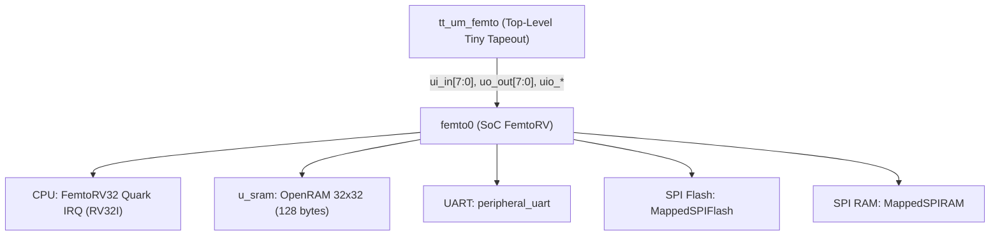

# Entorno y Flujo de Simulación en TinyTapeout

Esta sección describe el flujo de trabajo directo desde el directorio de trabajo `tinytapeout/` (`asic_ram/VLSI/tinytapeout/`), explicando la jerarquía del SoC, la configuración del `Makefile`, los dos métodos de simulación disponibles (RTL estándar con Icarus Verilog y verificación funcional con Cocotb), y la solución a errores habituales de entorno y dependencias.

---

## 1. Estructura de Trabajo en `tinytapeout/`

La carpeta `tinytapeout/` contiene el entorno centralizado de pruebas y preparación física del chip Tiny Tapeout:

| Archivo | Rol en el flujo |
| :--- | :--- |
| `Makefile` | Script de automatización principal para síntesis y simulación (`make sim`, `make cocotb_openram`). |
| `tt_um_femto.v` | Netlist sintetizado y módulo top-level según la plantilla estándar de Tiny Tapeout. |
| `femto.v` | RTL top-level del SoC sincronizado con `femto_UN/src/femto.v` (incluye OpenRAM 32×32 y FemtoRV32 Quark IRQ). |
| `tt_um_femto_TB.v` | Banco de pruebas Verilog para simulación RTL con Icarus Verilog. |
| `tt_um_femto_cocotb.v` | Módulo *wrapper* para Cocotb con puertos de depuración expuestos. |
| `test_tt_um_femto_openram.py` | Testbench en Python con Cocotb que valida la OpenRAM 32×32, la máscara de byte y la UART. |
| `cores/sim_spi_flash/spiflash.v` | Modelo de simulación para la memoria de programa SPI Flash externa. |
| `cores/sim_spi_ram/spiram.v` | Modelo de memoria SPI FRAM externa (`module FRAM_SPI`). |

---

## 2. Jerarquía de Módulos: `tt_um_femto` vs `femto`

Uno de los aspectos clave del diseño es la diferenciación entre el envoltorio del chip y el SoC:



1. **`tt_um_femto` (Módulo Top-Level de Tiny Tapeout):**
   * Es el módulo requerido por el arnés de Tiny Tapeout (`info.yaml: top_module: "tt_um_femto"`).
   * Expone estrictamente los pines estándar: `ui_in[7:0]`, `uo_out[7:0]`, `uio_in[7:0]`, `uio_out[7:0]`, `uio_oe[7:0]`, `clk`, `rst_n` y `ena`.
   * Registra la señal de reset en el flanco de bajada de reloj (`always @(negedge clk) resetn <= rst_n`) para seguridad síncrona.

2. **`femto` (Núcleo del SoC):**
   * Es el núcleo interno instanciado dentro de `tt_um_femto` con el nombre de instancia `femto0`.
   * Conecta internamente la CPU con el decodificador de direcciones, la memoria **OpenRAM 32×32** (`u_sram`), el controlador UART y las interfaces SPI.

3. **Banco de Pruebas (`tt_um_femto_TB.v`):**
   * Instancia directamente a `tt_um_femto uut(...)`, conectando los pines de reloj, reset y los buses `ui_in` / `uo_out` a los modelos de SPI Flash y FRAM SPI.
   * Esto garantiza que la simulación pruebe exactamente el comportamiento del circuito integrado empaquetado.

---

## 3. Comandos de Simulación

Desde la carpeta `tinytapeout/`, el `Makefile` proporciona dos formas complementarias de simulación:

### 3.1 Simulación RTL Estándar (`make sim`)

Ejecuta el banco de pruebas Verilog clásico usando **Icarus Verilog**:

```bash
make sim
```

**Flujo interno ejecutado:**
1. Elimina artefactos temporales previos (`rm -f a.out *.vcd`).
2. Compila el testbench junto con el RTL del SoC y los modelos de memoria:
   ```bash
   iverilog -g2012 -DBENCH -DSIM -DPASSTHROUGH_PLL -DBOARD_FREQ=27 -DCPU_FREQ=27 \
     -s tt_um_femto_TB tt_um_femto_TB.v \
     ../femto_UN/src/femto.v \
     ../femto_UN/src/femtorv32_quark_un_irq.v \
     ../femto_UN/src/perip_uart.v ../femto_UN/src/uart.v \
     ../femto_UN/src/perip_mult.v ../femto_UN/src/mult.v ../femto_UN/src/bram.v \
     ../femto_UN/src/MappedSPIFlash.v ../femto_UN/src/MappedSPIRAM.v \
     cores/sim_spi_flash/spiflash.v cores/sim_spi_ram/spiram.v \
     ../femto_UN/macros/sky130_sram_32x32.v
   ```
3. Ejecuta el simulador con `vvp a.out`, cargando `firmware_flash.hex` y emitiendo por UART el saludo de inicio.
4. Genera el archivo de ondas `tt_um_femto_TB.vcd` y lanza GTKWave en segundo plano (`&`) sin bloquear la terminal.

---

### 3.2 Verificación Funcional con Cocotb (`make cocotb_openram`)

Ejecuta el entorno de verificación en Python que interactúa dinámicamente con los pines del SoC:

```bash
make cocotb_openram
```

**Validaciones realizadas automáticamente en el testbench:**
1. **Emulación SPI Flash:** Inyecta en caliente el programa de prueba `OPENRAM_PROGRAM` por `MISO`.
2. **Escritura Word de 32 bits:** La CPU ejecuta `sw x2, 0(x1)` con `wmask0 = 4'b1111`, escribiendo `0x1234564B` en la OpenRAM.
3. **Escritura selectiva por Byte:** La CPU ejecuta `sb x6, 1(x1)` con `wmask0 = 4'b0010`, modificando únicamente el byte 1 a `0xAA` (`0x1234AA4B`).
4. **Lectura Word:** La CPU ejecuta `lw x3, 0(x1)` y se comprueba mediante `assert` que el registro `x3` capture `0x1234AA4B`.
5. **Transmisión UART:** El SoC envía el byte 0 (`'K'` = `0x4B`) por `uart_tx` a 115200 baudios, y el monitor de Cocotb lo decodifica y verifica con éxito.

---

## 4. Resolución de Errores Comunes de Entorno

A continuación se documentan los errores encontrados durante la puesta en marcha y sus soluciones definitivas:

??? bug "Error 1: `tt_um_femto_TB.v: No such file or directory` / `No top level modules, and no -s option`"
    **Causa:**
    Al clonar o copiar el repositorio en una nueva carpeta (`asic_ram/`), el archivo `tt_um_femto_TB.v` no se había incluido en la carpeta `tinytapeout/`. Sin este archivo, `iverilog` solo encontraba los módulos fuente del procesador y no sabía cuál era el módulo raíz del testbench.

    **Solución:**
    1. Se copió el archivo de prueba `tt_um_femto_TB.v` a `asic_ram/VLSI/tinytapeout/`.
    2. En el `Makefile`, se especificó explícitamente el módulo raíz mediante `-s tt_um_femto_TB`:
       ```makefile
       sim: 
       	rm -f a.out *.vcd
       	iverilog -g2012 -DBENCH -DSIM -DPASSTHROUGH_PLL -DBOARD_FREQ=27 -DCPU_FREQ=27 -s tt_um_femto_TB tt_um_femto_TB.v ${OBJS} ${SIM_OBJS}
       	vvp a.out
       	gtkwave tt_um_femto_TB.vcd &
       ```

??? bug "Error 2: `make[1]: *** No rule to make target 'sim', needed by 'all'. Stop.`"
    **Causa:**
    Conflicto de versiones al mezclar variables de entorno entre distintos entornos virtuales de Python (por ejemplo, Cocotb 1.9.2 vs Cocotb 2.0). Si en el `Makefile` se forzaba una ruta fija en `PATH`, el ejecutable `cocotb-config` llamado por los sub-makefiles no correspondía con los archivos de inclusión (`Makefile.sim` y `Makefile.inc`), provocando que la regla de compilación `sim:` no fuera definida.

    **Solución:**
    Configurar en el `Makefile` la detección no invasiva mediante el operador `?=`:
    ```makefile
    COCOTB_MAKEFILES ?= $(shell cocotb-config --makefiles 2>/dev/null)
    ```
    De este modo, `make` utiliza de forma natural las rutas del entorno virtual activo del usuario (`which cocotb-config`) sin colisiones entre versiones.

??? bug "Error 3: `TypeError: Clock.__init__() got an unexpected keyword argument 'unit'`"
    **Causa:**
    En Cocotb versión 1.9.x, el argumento para especificar la unidad de tiempo en la clase `Clock` es `units="ps"`. En Cocotb versión 2.0+, dicho parámetro fue renombrado a `unit="ps"`. Al ejecutarse sobre Cocotb 1.9.2 con `unit="ps"`, el constructor lanzaba un `TypeError`.

    **Solución:**
    Implementar compatibilidad cruzada en `test_tt_um_femto_openram.py`:
    ```python
    try:
        clock = Clock(dut.clk, 37038, units="ps")  # Cocotb <= 1.9.2
    except TypeError:
        clock = Clock(dut.clk, 37038, unit="ps")   # Cocotb >= 2.0.0
    ```
