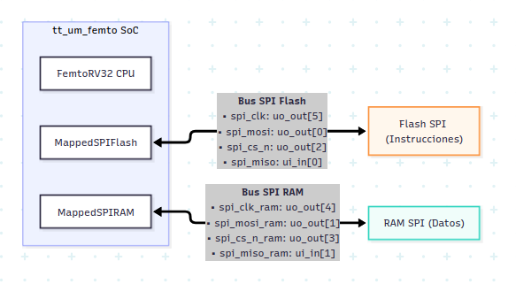
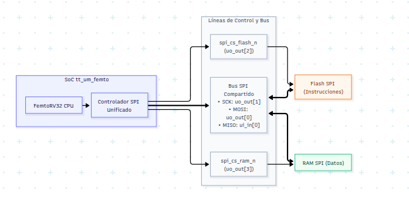

## 1. Resumen Ejecutivo y Objetivos

En la arquitectura original del SoC `tt_um_femto`, la memoria **Flash SPI** (que almacena las instrucciones del procesador) y la memoria **RAM SPI** (que almacena variables y datos dinámicos) utilizaban **dos controladores SPI independientes**, consumiendo un total de **8 pines dedicados** (6 salidas y 2 entradas).

En la plataforma **Tiny Tapeout**, los pines de E/S son un recurso crítico (solo se dispone de 8 entradas dedicadas `ui_in` y 8 salidas dedicadas `uo_out`). El objetivo de esta implementación (**Caso B: Nuevo RTL**) fue:
1. Diseñar e integrar un **Controlador SPI Maestro Unificado** capaz de gobernar tanto la Flash como la RAM sobre un **único bus SPI compartido** (`SCK`, `MOSI`, `MISO`), diferenciando los accesos mediante dos líneas independientes de selección (`CS_FLASH_N` y `CS_RAM_N`).
2. **Reducir el consumo de pines de 8 a 5**, liberando 3 pines físicos en el chip para UART, interrupciones o GPIOs.
3. Verificar el sistema mediante simulación en **Icarus Verilog / GTKWave**, ejecutando un firmware que escribe un texto en la RAM SPI, lo lee palabra por palabra y lo transmite exitosamente a través del periférico UART a 115200 baudios.

---

## 2. Arquitectura de Hardware: Antes vs. Después

### Arquitectura Original (2 Buses Separados - 8 Pines)




### Arquitectura Nueva: Bus SPI Compartido (5 Pines)



### Cuadro Comparativo de Pines de Tiny Tapeout

| Pin Tiny Tapeout | Rol en Diseño Original | Rol en Nuevo Diseño (Caso B) | Estado |
| :--- | :--- | :--- | :--- |
| `uo_out[1]` | `spi_mosi_ram` (RAM) | `spi_sck` (Compartido Flash + RAM) | Optimizado |
| `uo_out[4]` | `spi_clk_ram` (RAM) | `mem_busy_debug` (Depuración) | **LIBERADO** |
| `uo_out[5]` | `spi_clk` (Flash) | `debug_out` (Depuración acceso RAM) | **LIBERADO** |
| `ui_in[1]` | `spi_miso_ram` (RAM) | *Sin conectar / GPIO libre* | **LIBERADO** |

## 3. Detalle de Archivos Creados y Modificados

### 3.1. [NUEVO] `femto_UN/src/Unified_SPI_Controller.v`
Este módulo reemplaza por completo a `MappedSPIFlash.v` y `MappedSPIRAM.v`. Implementa un maestro SPI en **Modo 0 (CPOL=0, CPHA=0)** y soporta lecturas de Flash, lecturas de RAM y escrituras en RAM (incluyendo el envío mandatorio del comando `WREN` antes de escribir).

??? info "Código Verilog: Unified_SPI_Controller.v "
    ```verilog
    /*
    - Unified_SPI_Controller.v
    - Controlador SPI Maestro Unificado para bus compartido (Flash + RAM)
    - Proyecto: tt_um_femto
     */

    `default_nettype none

    module Unified_SPI_Controller #(
        parameter CLK_DIV = 2  // Base de tiempo para SCK: periodo SCK = 2 * CLK_DIV ciclos
    )(
        input  wire        clk,
        input  wire        resetn,

        // Interfaz con FemtoRV32
        input  wire [31:0] mem_addr,
        input  wire [31:0] mem_wdata,
        input  wire [3:0]  mem_wmask,
        input  wire        mem_rstrb,
        output reg  [31:0] mem_rdata,
        output wire        mem_busy,

        // Pines externos hacia el bus SPI compartido (5 pines)
        output reg         spi_cs_flash_n,
        output reg         spi_cs_ram_n,
        output reg         spi_sck,
        output wire        spi_mosi,
        input  wire        spi_miso
    );

        // Decodificación de direcciones del SoC
        // 0x0000_0000 - 0x0000_FFFF: Flash SPI (Instrucciones / rodata)
        // 0x0001_0000 - 0x0001_FFFF: RAM SPI   (Datos)
        wire is_flash = (mem_addr == 16'h0000);
        wire is_ram   = (mem_addr == 16'h0001);

        wire rd = mem_rstrb & (is_flash | is_ram);
        wire wr = (|mem_wmask) & is_ram;

        // FSM States
        localparam ST_IDLE       = 3'd0;
        localparam ST_WREN       = 3'd1;
        localparam ST_WREN_GAP   = 3'd2;
        localparam ST_CMD_ADDR   = 3'd3;
        localparam ST_TRANSFER   = 3'd4;
        localparam ST_DESELECT   = 3'd5;

        reg [2:0]  state;
        reg [5:0]  bit_cnt;
        reg [31:0] shift_out;
        reg [31:0] shift_in;
        reg [23:0] addr_reg;
        reg [31:0] wdata_reg;
        reg        is_write_op;

        // En Modo 0 (CPOL=0, CPHA=0), MOSI presenta siempre shift_out[31].
        assign spi_mosi = shift_out[31];

        // Divisor de reloj para SCK
        reg [3:0] clk_cnt;
        wire tick = (clk_cnt == CLK_DIV - 1);

        always @(posedge clk or negedge resetn) begin
            if (!resetn) begin
                clk_cnt <= 4'd0;
            end else if (state == ST_WREN || state == ST_CMD_ADDR || state == ST_TRANSFER) begin
                clk_cnt <= tick ? 4'd0 : clk_cnt + 4'd1;
            end else begin
                clk_cnt <= 4'd0;
            end
        end

        // Señal busy combinacional hacia el procesador:
        // Debe activarse también inmediatamente cuando wr se solicita en ST_IDLE,
        // para que la CPU FemtoRV32 no pase de largo en WAIT_ALU_OR_MEM.
        assign mem_busy = (state != ST_IDLE) || wr;

        always @(posedge clk or negedge resetn) begin
            if (!resetn) begin
                state          <= ST_IDLE;
                spi_cs_flash_n <= 1'b1;
                spi_cs_ram_n   <= 1'b1;
                spi_sck        <= 1'b0;
                bit_cnt        <= 6'd0;
                mem_rdata      <= 32'd0;
                shift_out      <= 32'd0;
                shift_in       <= 32'd0;
                addr_reg       <= 24'd0;
                wdata_reg      <= 32'd0;
                is_write_op    <= 1'b0;
            end else begin
                case (state)

                    ST_IDLE: begin
                        spi_sck        <= 1'b0;
                        spi_cs_flash_n <= 1'b1;
                        spi_cs_ram_n   <= 1 meb1;
                        bit_cnt        <= 6'd0;

                        if (wr) begin
                            // Escritura a RAM (requiere comando WREN 0x06 previo)
                            is_write_op  <= 1'b1;
                            addr_reg     <= {8'h00, mem_addr[15:2], 2'b00};
                            // Byte 0 (mem_wdata[7:0]) viaja primero en Little-Endian
                            wdata_reg    <= {mem_wdata[7:0], mem_wdata[15:8], mem_wdata, mem_wdata};
                            spi_cs_ram_n <= 1'b0;
                            shift_out    <= 32'h06000000; // Comando 0x06 (WREN)
                            state        <= ST_WREN;
                        end else if (rd) begin
                            is_write_op <= 1'b0;
                            if (is_ram) begin
                                addr_reg     <= {8'h00, mem_addr[15:2], 2'b00};
                                spi_cs_ram_n <= 1'b0;
                                shift_out    <= {8'h03, 8'h00, mem_addr[15:2], 2'b00};
                            end else begin
                                addr_reg       <= {mem_addr[23:2], 2'b00};
                                spi_cs_flash_n <= 1'b0;
                                shift_out      <= {8'h03, mem_addr[23:2], 2'b00};
                            end
                            state <= ST_CMD_ADDR;
                        end
                    end

                    ST_WREN: begin
                        if (tick) begin
                            spi_sck <= ~spi_sck;
                            if (spi_sck) begin
                                // Flanco de bajada de SCK: desplazar
                                if (bit_cnt == 6'd7) begin
                                    state   <= ST_WREN_GAP;
                                    bit_cnt <= 6'd0;
                                end else begin
                                    shift_out <= {shift_out[30:0], 1'b0};
                                    bit_cnt   <= bit_cnt + 6'd1;
                                end
                            end
                        end
                    end

                    ST_WREN_GAP: begin
                        spi_sck      <= 1'b0;
                        spi_cs_ram_n <= 1'b1;
                        bit_cnt      <= bit_cnt + 6'd1;
                        if (bit_cnt >= 6'd3) begin
                            spi_cs_ram_n <= 1'b0; // Baja CS para iniciar WRITE
                            shift_out    <= {8'h02, addr_reg}; // Comando 0x02 + Dirección
                            bit_cnt      <= 6'd0;
                            state        <= ST_CMD_ADDR;
                        end
                    end

                    ST_CMD_ADDR: begin
                        if (tick) begin
                            spi_sck <= ~spi_sck;
                            if (spi_sck) begin
                                // Flanco de bajada de SCK: desplazar o transicionar
                                if (bit_cnt == 6'd31) begin
                                    bit_cnt   <= 6'd0;
                                    state     <= ST_TRANSFER;
                                    shift_out <= is_write_op ? wdata_reg : 32'd0;
                                end else begin
                                    shift_out <= {shift_out[30:0], 1'b0};
                                    bit_cnt   <= bit_cnt + 6'd1;
                                end
                            end
                        end
                    end

                    ST_TRANSFER: begin
                        if (tick) begin
                            spi_sck <= ~spi_sck;
                            if (!spi_sck) begin
                                // Flanco de subida de SCK: Muestreo de MISO
                                if (!is_write_op) begin
                                    shift_in <= {shift_in[30:0], spi_miso};
                                end
                            end else begin
                                // Flanco de bajada de SCK: Desplazamiento o fin
                                if (bit_cnt == 6'd31) begin
                                    bit_cnt <= 6'd0;
                                    state   <= ST_DESELECT;
                                    if (!is_write_op) begin
                                        // Reorganizar a Little-Endian para FemtoRV32
                                        mem_rdata <= {
                                            shift_in[7:0],   // Byte 3
                                            shift_in[15:8],  // Byte 2
                                            shift_in, // Byte 1
                                            shift_in  // Byte 0
                                        };
                                    end
                                end else begin
                                    if (is_write_op) begin
                                        shift_out <= {shift_out[30:0], 1'b0};
                                    end
                                    bit_cnt <= bit_cnt + 6'd1;
                                end
                            end
                        end
                    end

                    ST_DESELECT: begin
                        spi_sck        <= 1'b0;
                        spi_cs_flash_n <= 1'b1;
                        spi_cs_ram_n   <= 1'b1;
                        bit_cnt        <= bit_cnt + 6'd1;
                        if (bit_cnt >= 6'd3) begin
                            state <= ST_IDLE;
                        end
                    end

                    default: state <= ST_IDLE;
                endcase
            end
        end

    endmodule
    ```
---

### 3.2. [MODIFICADO] `femto_UN/src/femto.v`
# Lista de Modificaciones RTL (`tt_um_femto` y `femto`)

* Se reemplazaron las instancias de `MappedSPIFlash` y `MappedSPIRAM` por `Unified_SPI_Controller`.
* Se conectaron los pines del bus compartido a `uo_out[0..3]` y `ui_in[0]`.
* Se enrutaron señales de depuración (`mem_busy_debug` y `debug_out`) a los pines liberados `uo_out[4..5]`.
* Se simplificó el multiplexor de lectura `mem_rdata`.


??? info "Parche Git: Integración de Unified_SPI_Controller en femto.v (Clic para expandir)"
    ```diff
    --- a/femto_UN/src/femto.v
    +++ b/femto_UN/src/femto.v
    @@ -17,28 +17,25 @@ module tt_um_femto(
    -   femto femto0( 
    -       .clk          (clk), 
    -       .resetn       (resetn), 
    -       .spi_mosi     (uo_out[0]),
    -       .spi_mosi_ram (uo_out[1]),
    -       .spi_cs_n     (uo_out[2]),
    -       .spi_cs_n_ram (uo_out[3]),
    -       .spi_clk_ram  (uo_out[4]),
    -       .spi_clk      (uo_out[5]),
    -       .LEDS         (uo_out[6]),
    -       .TXD          (uo_out[7]),
    -       
    -       .spi_miso     (ui_in[0]),
    -       .spi_miso_ram (ui_in[1]),
    -       .RXD          (ui_in[2]),
    -      .interrupt_request (ui_in[3])
    -   );
    +    femto femto0( 
    +        .clk               (clk), 
    +        .resetn            (resetn), 
    +        .spi_mosi          (uo_out[0]), // MOSI compartido
    +        .spi_sck           (uo_out[1]), // SCK compartido
    +        .spi_cs_flash_n    (uo_out[2]), // CS Flash
    +        .spi_cs_ram_n      (uo_out[3]), // CS RAM
    +        .mem_busy_debug    (uo_out[4]), // Señal de depuración (mem_busy)
    +        .debug_out         (uo_out[5]), // Señal de depuración (RAM access)
    +        .LEDS              (uo_out[6]),
    +        .TXD               (uo_out[7]),
    +        .spi_miso          (ui_in[0]),  // MISO compartido
    +        .RXD               (ui_in[2]),
    +        .interrupt_request (ui_in[3])
    +    );
    @@ -70,52 +67,31 @@ module femto (
    -   output        spi_mosi,
    -   input         spi_miso,
    -   output        spi_cs_n,
    -   output        spi_clk,
    -   output      spi_clk_ram,
    -   output      spi_cs_n_ram,
    -   input       spi_miso_ram,
    -   output      spi_mosi_ram,
    +   output        spi_mosi,
    +   output        spi_sck,
    +   output        spi_cs_flash_n,
    +   output        spi_cs_ram_n,
    +   input         spi_miso,
    +   output        mem_busy_debug,
    +   output        debug_out,
    @@ -80,102 +77,75 @@ module femto (
           .mem_rstrb(mem_rstrb),
           .mem_wdata(mem_wdata),
           .mem_wmask(mem_wmask),
    -      .mem_rbusy(mapped_spi_flash_rbusy | spi_ram_rbusy),
    -      .mem_wbusy(spi_ram_wbusy),
    +      .mem_rbusy(spi_mem_busy),
    +      .mem_wbusy(spi_mem_busy),
           .interrupt_request(interrupt_request)
        );

    -   MappedSPIRAM mapped_spi_ram(...);
    -   MappedSPIFlash mapped_spi_flash(...);
    +   Unified_SPI_Controller #(
    +      .CLK_DIV(2)
    +   ) spi_ctrl (
    +      .clk            (clk),
    +      .resetn         (resetn),
    +      .mem_addr       (mem_address),
    +      .mem_wdata      (mem_wdata),
    +      .mem_wmask      (mem_wmask),
    +      .mem_rstrb      (mem_rstrb),
    +      .mem_rdata      (spi_rdata),
    +      .mem_busy       (spi_mem_busy),
    +      .spi_cs_flash_n (spi_cs_flash_n),
    +      .spi_cs_ram_n   (spi_cs_ram_n),
    +      .spi_sck        (spi_sck),
    +      .spi_mosi       (spi_mosi),
    +      .spi_miso       (spi_miso)
    +   );

    +   assign mem_busy_debug = spi_mem_busy;
    +   assign debug_out      = cs[6];
    ```

### 3.3. [MODIFICADO] `tinytapeout/tt_um_femto_TB.v`
Se actualizó la interconexión física en el banco de pruebas:
1. `flash0` y `flashram0` ahora se conectan a los mismos cables: `spi_clk`, `spi_mosi` y `spi_miso`.
2. Se incorporó un búfer tri-state de emulación con resistencia pull-up para la línea `MISO`.

??? info "Parche Git: Actualización del Banco de Pruebas (tt_um_femto_TB.v) (Clic para expandir)"
    ```diff
    --- a/tinytapeout/tt_um_femto_TB.v
    +++ b/tinytapeout/tt_um_femto_TB.v
    @@ -20,10 +20,10 @@ wire VGND = 1'b0;
       wire spi_cs;
    +  wire spi_cs_n_ram;
       wire spi_clk;
       wire spi_miso;
    -  wire spi_mosi;
    -  wire spi_cs_n_ram;
    -  wire spi_clk_ram;
    -  wire spi_miso_ram;
    -  wire spi_mosi_ram;
    +  wire ram_so;
    +  wire mem_busy_debug;
    +  wire debug_out;
    @@ -36,8 +36,8 @@ tt_um_femto uut(
    -   .ui_in  ({4'b0000, interrupt_request, RXD, spi_miso_ram, spi_miso}),
    -   .uo_out ({TXD, LEDS, spi_clk, spi_clk_ram, spi_cs_n_ram, spi_cs, spi_mosi_ram, spi_mosi}));
    +   .ui_in  ({4'b0000, interrupt_request, RXD, 1'b0, spi_miso}),
    +   .uo_out ({TXD, LEDS, debug_out, mem_busy_debug, spi_cs_n_ram, spi_cs, spi_clk, spi_mosi}));
    @@ -74,12 +74,16 @@ tt_um_femto uut(
       FRAM_SPI flashram0(
        .CSB(spi_cs_n_ram),     // Chip Select (activo en bajo)
    -   .SCK(spi_clk_ram),    // SPI Clock
    -   .SI(spi_mosi_ram),     // Serial Input (MOSI)
    -   .SO(spi_miso_ram),     // Serial Output (MISO)
    +   .SCK(spi_clk),          // SPI Clock compartido
    +   .SI(spi_mosi),          // MOSI compartido
    +   .SO(ram_so),            // Salida de RAM
        .VDD(reset_n),
        .WPB(1'b1)
       );
    +  // Búfer tri-state para emular el comportamiento real del pin MISO de la RAM
    +  assign spi_miso = (!spi_cs_n_ram) ? ram_so : 1'bz;
    +  pullup(spi_miso);
    ```

### 3.4. [MODIFICADO] `tinytapeout/Makefile`
Se sustituyeron las fuentes de los controladores individuales por el nuevo controlador unificado en la lista `OBJS`:

```diff
--- a/tinytapeout/Makefile
+++ b/tinytapeout/Makefile
@@ -13,8 +13,7 @@ OBJS+= ../femto_UN/src/uart.v
 OBJS+= ../femto_UN/src/perip_mult.v
 OBJS+= ../femto_UN/src/mult.v
 OBJS+= ../femto_UN/src/bram.v
-OBJS+= ../femto_UN/src/MappedSPIFlash.v
-OBJS+= ../femto_UN/src/MappedSPIRAM.v
+OBJS+= ../femto_UN/src/Unified_SPI_Controller.v
```

---

### 3.5. [RECOMPILADO] `tinytapeout/firmware/asm/test_ram_load.S`
Código fuente en ensamblador RISC-V del test funcional. Escribe 12 bytes en la RAM SPI, los lee palabra a palabra y los transmite serialmente por UART:

??? info "Código Ensamblador RISC-V: test_ram_load.S (Clic para expandir)"
    ```assembly
    .section .text
    .global _start

    _start:
        nop
        lui   t1, 0x400
        addi  t1, t1, 8            # t1 = 0x00400008 (UART TX data)
        lui   t2, 0x400
        addi  t2, t2, 16           # t2 = 0x00400010 (UART TX ctrl/status)
        lui   t0, 0x10             # t0 = 0x00010000 (Base RAM SPI)

        # ---- Escribe 3 palabras (12 bytes) a la RAM SPI ----
        li    t3, 0x6C6C6548        # "Hell" en little-endian
        sw    t3, 0(t0)
        li    t3, 0x6F57206F        # "o Wo"
        sw    t3, 4(t0)
        li    t3, 0x00646C72        # "rld\0"
        sw    t3, 8(t0)

    restart:
        li    s0, 0                 # Offset de palabra dentro de la RAM (0, 4, 8)

    word_loop:
        add   t4, t0, s0
        lw    s1, 0(t4)             # Lectura de palabra completa (32 bits) desde RAM SPI
        li    s2, 4                 # Contador: 4 bytes por palabra

    byte_loop:
        andi  t4, s1, 0xFF          # Extrae el byte menos significativo
        beqz  t4, restart           # Si es '\0', reinicia el ciclo ("Hello World")

    wait_tx:
        lw    t5, 0(t2)
        andi  t5, t5, 0x200         # Bit 9: tx_busy
        bnez  t5, wait_tx
        sw    t4, 0(t1)             # Escribe dato en UART DATA
        li    t6, 0x08
        sw    t6, 0(t2)             # Pulso tx_wr = 1
        li    t6, 0x00
        sw    t6, 0(t2)             # tx_wr = 0
        srli  s1, s1, 8             # Desplaza al siguiente byte de la palabra
        addi  s2, s2, -1
        bnez  s2, byte_loop
        addi  s0, s0, 4             # Avanza a la siguiente palabra
        j     word_loop
    ```
---

## 4. Problemas Críticos Encontrados y Soluciones de Ingeniería

### Problema 1: Asignación No-Bloqueante de `mem_wmask` y el "Escape" de la CPU
??? info "Ver mas"
    - **Síntoma:** Al simular, el procesador escribía únicamente la primera palabra en la RAM (`"Hell"`), pero jamás avanzaba a escribir la segunda (`"o Wo"`) ni transmitía el mensaje completo. Se quedaba repitiendo la primera escritura de forma infinita.
    - **Análisis Profundo:**
    - En `femtorv32_quark_un_irq.v`, la señal `mem_wmask` es generada en un bloque síncrono con asignación no-bloqueante:  
        `mem_wmask <= {4{isStore}} & STORE_wmask;`
    - Esto significa que durante el ciclo `EXECUTE`, `mem_wmask` vale `4'b0000`. Su valor pasa a `4'b1111` únicamente cuando la CPU ya ha ingresado al ciclo `WAIT_ALU_OR_MEM`.
    - Inicialmente, el controlador SPI calculaba:  
        `assign mem_busy = (state != ST_IDLE);`
    - Como el controlador estaba en `ST_IDLE`, en el primer flanco de reloj de `WAIT_ALU_OR_MEM`, la señal `mem_wbusy` valía `0`.
    - La condición de salida del estado en la CPU era:  
        `if (!aluBusy && !mem_rbusy && !mem_wbusy) state <= FETCH_INSTR;`
    - Dado que `mem_wbusy` era `0`, **la CPU abandonaba `WAIT_ALU_OR_MEM` en un solo ciclo**, pasando a `FETCH_INSTR` y luego a `WAIT_INSTR`.
    - En el siguiente ciclo, el controlador SPI finalmente detectaba `wr == 1` y comenzaba la escritura a la RAM (que tarda $\sim 12\,\mu\text{s}$). Durante todo ese tiempo, la CPU esperaba en `WAIT_INSTR` creyendo que esperaba una instrucción de la Flash.
    - Al terminar la escritura de la RAM, `mem_busy` caía a `0`. La CPU despertaba en `WAIT_INSTR`, **asumía erróneamente que la RAM le había devuelto una instrucción**, cargaba ese valor basura en el decodificador de instrucciones y descontrolaba el flujo del programa.
    - **Solución Implementada:**
    Se modificó la señal de estado hacia el procesador para que responda de forma **combinacional inmediata**:
    ```verilog
    assign mem_busy = (state != ST_IDLE) || wr;
    ```
    Con `|| wr`, en cuanto `mem_wmask` se activa en `WAIT_ALU_OR_MEM`, `mem_busy` sube a `1` en ese mismo instante. Esto congela a la CPU en `WAIT_ALU_OR_MEM` hasta que el controlador concluye la totalidad de la transacción SPI.

    ---

### Problema 2: Contención de Bus `X` en Simulación por el Modelo de la RAM
??? info "Ver mas"
    - **Síntoma:** Al iniciar la simulación, la señal `spi_miso` presentaba estados desconocidos `X` (rojo en GTKWave).
    - **Causa:** El modelo de simulación de Cypress (`cores/sim_spi_ram/spiram.v`) fuerza su salida `SO = 0` cuando `CSB = 1` en vez de colocarla en alta impedancia `1'bz`. Cuando la Flash intentaba responder con un `1`, ambos modelos peleaban por la línea.
    - **Solución:** Se agregó un búfer tri-state en el testbench (`assign spi_miso = (!spi_cs_n_ram) ? ram_so : 1'bz;`), reflejando el comportamiento del silicio comercial real.

---

### Problema 3: Sign-Extension en Ensamblador (`0xFC` vs `0x6C`)
??? info "Ver mas"
    - **Síntoma:** Al inspeccionar `mem[3]` en la RAM, contenía `0xFC` en vez de `0x6C` (`'l'`).
    - **Causa:** Un archivo `.elf` anterior en el repositorio se había generado con una herramienta donde `li t3, 0x6C6C6548` extendía signo produciendo `lui t3, 0xfc6c6`.
    - **Solución:** Se limpió el directorio `tinytapeout/firmware/asm/` y se recompiló con `riscv32-unknown-elf-as -march=rv32i -mabi=ilp32`, generando con exactitud `0x6C6C6548`.

---

## 5. Análisis de la Forma de Onda en GTKWave

Al visualizar la señal `per_uart.d_in[7:0]` o decodificar el pin de transmisión `TXD`, se observa la secuencia:
```text
'H'  'e'  'l'  'o'  ' '  'W'  'o'  'r'  'l'  'd'
```

### ¿Por qué la primera `'l'` aparece con una casilla doble de ancha?
1. **La palabra inglesa es "He<mark>ll</mark>o":** Contiene dos letras `'l'` consecutivas (`0x6C` y `0x6C`).
2. **Representación de buses en visores digitales:** GTKWave únicamente dibuja la línea divisoria ("X") cuando el valor binario del bus cambia. Al transmitirse la primera `'l'` (`0x6C`) y mantenerse en `'l'` (`0x6C`) para la segunda, el bus no experimenta transición, por lo que el visualizador dibuja **una sola casilla continua que dura el doble de tiempo**.
3. **Comprobación:** La segunda `'l'` de la palabra **"Wor<mark>l</mark>d"** (entre la `'r'` y la `'d'`) aparece con el ancho estándar de una sola letra, confirmando la validez del decodificador.

---

## 6. Guía de Reproducción y Verificación Manual

### Paso 1: Ubicación en el repositorio
```bash
cd /home/villa/VLSI/tinytapeout
git checkout bus-compartido-spi
```

### Paso 2: (Opcional) Recompilación del Firmware
```bash
cd /home/villa/VLSI/tinytapeout/firmware/asm
make clean && make
cd ../..
```

### Paso 3: Compilación y Ejecución con Icarus Verilog
```bash
iverilog -DBENCH -DSIM -DPASSTHROUGH_PLL -DBOARD_FREQ=27 -DCPU_FREQ=27 \
  tt_um_femto_TB.v \
  ../femto_UN/src/femto.v \
  ../femto_UN/src/femtorv32_quark_un_irq.v \
  ../femto_UN/src/perip_uart.v \
  ../femto_UN/src/uart.v \
  ../femto_UN/src/perip_mult.v \
  ../femto_UN/src/mult.v \
  ../femto_UN/src/bram.v \
  ../femto_UN/src/Unified_SPI_Controller.v \
  cores/sim_spi_flash/spiflash.v \
  cores/sim_spi_ram/spiram.v

vvp a.out
```

### Paso 4: Visualización en GTKWave
```bash
gtkwave tt_um_femto_TB.vcd
```
Señales recomendadas para agregar:
- `tt_um_femto_TB.spi_clk` (SCK compartido)
- `tt_um_femto_TB.spi_mosi` (MOSI compartido)
- `tt_um_femto_TB.spi_miso` (MISO compartido)
- `tt_um_femto_TB.spi_cs` (CS Flash)
- `tt_um_femto_TB.spi_cs_n_ram` (CS RAM)
- `tt_um_femto_TB.TXD` (Salida serial UART)
- `tt_um_femto_TB.flashram0.mem[0..11]` (Formato de datos: ASCII)
- `tt_um_femto_TB.uut.femto0.per_uart.d_in[7:0]` (Formato de datos: ASCII)