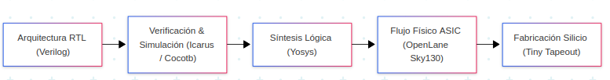

# Documentación del Proyecto SoC VLSI — Tiny Tapeout FemtoRV32

Bienvenido al portal de documentación del **SoC VLSI Tiny Tapeout**, un proyecto de diseño e implementación de un microprocesador basado en la arquitectura de código abierto **RISC-V (RV32I)**, diseñado para fabricación en tecnología de **130 nm** (*SkyWater SKY130*) mediante la plataforma **Tiny Tapeout**.

---

##  Estructura de la Guía

La documentación está dividida en módulos temáticos para facilitar su consulta y lectura:

- **[Herramientas](tools/tools.md)**: Requisitos de software, dependencias y guías de instalación de herramientas de código abierto (Yosys, Icarus Verilog, GTKWave, Cocotb, OpenLane).
- **[Guía de Usuario](user/1-introduccion.md)**:
    - **[Introducción](user/1-introduccion.md)**: Arquitectura general, desglose de archivos del repositorio `VLSI`, mapa de memoria y consideraciones críticas del chip.
    - **[Simulación](user/2-simulacion.md)**: Compilación de programas en ensamblador, firmware (normal vs. shifted), pruebas automatizadas con Cocotb e inspección de formas de onda en GTKWave.
    - **[Síntesis](user/3-sintesis.md)**: Flujo de síntesis con Yosys, librería de celdas estándar Sky130 y presupuesto de área por baldosas de Tiny Tapeout.
    - **[Flujo Físico](user/4-openlane.md)**: Implementación física *RTL-to-GDSII* con OpenLane, extracción SPICE en Magic, comprobación DRC/LVS y generación de GDSII.

---

##  Características Principales del Chip

| Característica | Especificación |
| :--- | :--- |
| **Núcleo CPU** | FemtoRV32 Quark (Arquitectura RISC-V RV32I de 32 bits) |
| **Frecuencia Nominal** | 27 MHz |
| **Tecnología de Fabricación** | SkyWater 130 nm CMOS (PDK `sky130A`) |
| **Plataforma Tapeout** | Tiny Tapeout (Proyecto `tt_um_femto`, corrida *SKY25b*) |
| **Memoria de Datos** | Memoria externa RAM SPI + memoria RAM estática síncrona interna |
| **Periféricos Integrados** | UART (TX/RX serie a 115200 baudios), Multiplicador por hardware de 32 bits, GPIO/LEDs |
| **Entorno de Pruebas** | Uso de cocotb y GTKWave |

---

