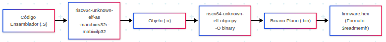

# Guía de Simulación y Generación de Firmware

Esta sección explica cómo compilar el software (firmware) en ensamblador RISC-V y cómo ejecutar la simulación del SoC para Tiny Tapeout utilizando Icarus Verilog y GTKWave.



---

## 1. Generación del Firmware

El repositorio cuenta con un `Makefile` dentro de `femtoRV/firmware/asm/` que automatiza todo el flujo de ensamblado, enlace y generación de las imágenes hexadecimales para la memoria Flash.


### Paso 1: Seleccionar el Programa a Compilar

En el archivo `femtoRV/firmware/asm/Makefile`, la variable `OBJECTS` define qué archivos objeto se compilarán y enlazarán en el binario final:

```makefile
# Ejemplo: seleccionar el programa de prueba deseado
OBJECTS = test_ram_load.o
# OBJECTS = blink.o
# OBJECTS = uart_full_demo.o putchar.o
```


### Paso 2: Ejecutar el Comando de Compilación

Desde el directorio de firmware, ejecute:

```bash
cd femtoRV/firmware/asm
make
```

??? info "Ver detalles de la ejecución interna "
    Este comando ejecuta de forma automatizada los siguientes procesos internos:

    1. **Ensamblado:** Compila los archivos fuente en ensamblador (`.S`) a objetos (`.o`) mediante `riscv32-unknown-elf-as` con las banderas `-march=rv32i -mabi=ilp32`.
    2. **Enlace:** Enlaza los objetos con el script de linker `bram.ld` usando `riscv32-unknown-elf-ld` para generar el ejecutable `firmware.elf`.
    3. **Extracción de Formatos:** Utiliza `riscv32-unknown-elf-objcopy` para generar:
       - `firmware.bin`: Binario plano del programa.
       - `firmware_flash.hex`: Archivo en formato hexadecimal Verilog cargado por el modelo de simulación de la Flash SPI.
    4. **Compensación de Corrimiento (Silicio Físico):** Ejecuta el script `fix_shift.py` para generar `firmware_shifted.hex`, compensando el desplazamiento de 1 bit del silicio original.
    5. **Copia de Archivos:** Transfiere automáticamente las imágenes hexadecimales generadas a las carpetas destino para la simulación.
---

## 2. Simulación del SoC Tiny Tapeout

La simulación se ejecuta desde la carpeta `tinytapeout/`.


### Paso 1: Ejecutar la Simulación con Make

Navegue a la carpeta `tinytapeout/` y ejecute:


```bash
cd tinytapeout
make sim
```

??? info "Ver detalles de la ejecución interna "
    El comando realiza los siguientes pasos de manera automática:

    1. **Limpieza:** Elimina simulaciones previas (`rm -f a.out *.vcd`).
    2. **Compilación (Icarus Verilog):** Ensambla el banco de pruebas y los módulos RTL ejecutando internamente:  
       `iverilog -DBENCH -DSIM -DPASSTHROUGH_PLL -DBOARD_FREQ=27 -DCPU_FREQ=27 tt_um_femto_TB.v ${OBJS}${SIM_OBJS}`
    3. **Simulación (VVP):** Ejecuta el motor con `vvp a.out`. El modelo `spiflash.v` lee automáticamente el firmware mediante `$readmemh` y el procesador inicia su ciclo de *fetch*.
    4. **Registro:** Genera el archivo de ondas `tt_um_femto_TB.vcd`.
    5. **Visualización:** Abre **GTKWave** de forma automática para ver las señales.
---

## 3. Visualización e Inspección de Señales en GTKWave

Una vez abierto GTKWave (o ejecutando manualmente `gtkwave tt_um_femto_TB.vcd &`), las principales señales a inspeccionar son:

- **Reloj y Reset**:
  - `CLK`: Reloj maestro de simulación (27 MHz).
  - `RESET`: Señal de inicialización y reset.

- **Pines de Tiny Tapeout (`ui_in` y `uo_out`)**:
  - `uo_out[0]` (`MOSI`) y `ui_in[0]` (`MISO`): Líneas de datos de la Flash SPI.
  - `uo_out[2]` (`CS#`): Selección de chip de la memoria Flash (activo en bajo durante lectura de instrucciones).
  - `uo_out[5]` (`SCK`): Reloj generado para el bus serie SPI.
  - `uo_out[7]` (`TXD`) y `ui_in[2]` (`RXD`): Comunicación serie UART.

- **Registros Internos del Procesador**:
  - `tt_um_femto_TB.uut.femto0.CPU.registerFile`: Arreglo de los 32 registros del procesador RISC-V (`x0` a `x31`) para verificar los resultados de las instrucciones ejecutadas.
  - `tt_um_femto_TB.flashram0.mem`: Contenido de la memoria RAM SPI externa.
