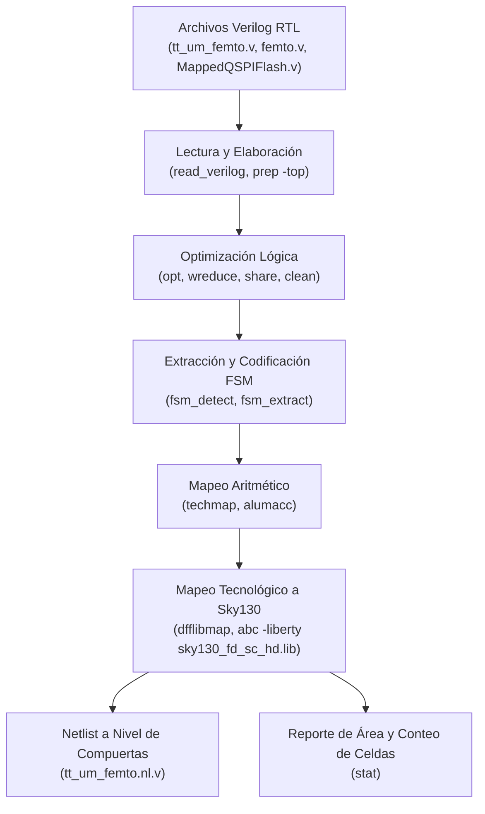

# Guía de Síntesis Lógica con Yosys

La síntesis lógica es el proceso de convertir el código fuente descrito en Verilog RTL en una red de interconexión de compuertas lógicas (*gate-level netlist*) mapeada a las celdas estándar de la biblioteca tecnológica del fabricante (en este caso, **SkyWater 130 nm HD**).

---

## 1. Flujo General de Síntesis en Tiny Tapeout

En la plataforma Tiny Tapeout, la herramienta principal para la síntesis lógica es **Yosys**, integrada dentro del flujo automatizado de OpenLane:



---

## 2. Requisitos y Librería Tecnológica

- **PDK**: SkyWater 130 nm CMOS (`sky130A`).
- **Librería de Celdas Estándar**: `sky130_fd_sc_hd` (High Density), diseñada para maximizar la densidad de compuertas por unidad de área.
- **Herramienta**: Yosys versión 0.30 o superior con plugin ABC integrado.

---

## 3. Script de Síntesis Básico (`synth.tcl`)

A continuación se presenta un script representativo de síntesis para el módulo top-level `tt_um_femto`:

```tcl
# 1. Leer definiciones y archivos fuente RTL
read_verilog -sv ../femto_UN/src/MappedQSPIFlash.v
read_verilog -sv ../femto_UN/src/MappedSPIRAM.v
read_verilog -sv ../femto_UN/src/perip_uart.v
read_verilog -sv ../femto_UN/src/perip_mult.v
read_verilog -sv ../femto_UN/src/femtorv32_quark_un_irq.v
read_verilog -sv ../femto_UN/src/femto.v
read_verilog -sv tt_um_femto.v

# 2. Elaborar la jerarquía teniendo como top a tt_um_femto
hierarchy -check -top tt_um_femto

# 3. Síntesis genérica
proc; opt; fsm; opt; memory; opt

# 4. Mapeo a celdas Sky130
dfflibmap -liberty $::env(PDK_ROOT)/sky130A/libs.ref/sky130_fd_sc_hd/lib/sky130_fd_sc_hd__tt_025C_1v80.lib
abc -liberty $::env(PDK_ROOT)/sky130A/libs.ref/sky130_fd_sc_hd/lib/sky130_fd_sc_hd__tt_025C_1v80.lib

# 5. Limpieza y estadísticas
clean
stat -liberty $::env(PDK_ROOT)/sky130A/libs.ref/sky130_fd_sc_hd/lib/sky130_fd_sc_hd__tt_025C_1v80.lib

# 6. Escribir netlist sintetizado
write_verilog -noattr tt_um_femto_synth.v
```

---

## 4. Presupuesto de Área y Restricciones en Tiny Tapeout

En Tiny Tapeout, cada diseño debe encajar dentro de un número entero de **baldosas** (*tiles*):

- **Área de 1 Baldosa Estándar (1x1)**: Aprox. $160\ \mu\text{m} \times 100\ \mu\text{m}$ (capacidad aprox. de 800 a 1,200 compuertas lógicas estándar).
- **SoC tt_um_femto**: Debido a que incluye núcleo procesador RV32I completo, banco de 32 registros, controlador QSPI, multiplicador por hardware y UART, el diseño suele dimensionarse en **1x2 baldosas** o **2x2 baldosas** (con un presupuesto de ~2,500 a 3,500 celdas).

!!! tip "Estrategias para Minimizar Área"
    - **Banco de Registros**: Si el área es muy ajustada, se puede configurar FemtoRV32 en modo RV32E (16 registros en lugar de 32).
    - **Multiplicador**: Utilizar multiplicación secuencial iterativa por software o por registros de desplazamiento si el multiplicador paralelo consume demasiadas compuertas.
    - **Lógica de Decodificación**: Mantener comparadores de máscara de dirección fijos para el decodificador de memoria MMIO.
