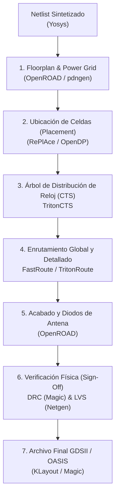

# Guía de Flujo Físico ASIC con OpenLane

OpenLane es un flujo automatizado de diseño físico de circuitos integrados (*RTL-to-GDSII*) basado en herramientas de código abierto como OpenROAD, Yosys, Magic, Netgen y KLayout. En esta sección se describe cómo se implementa físicamente el SoC `tt_um_femto` sobre la tecnología **SkyWater 130 nm**.

---

## 1. Etapas del Flujo Físico en OpenLane



---

## 2. Configuración y Ejecución del Flujo

### Acceso al Contenedor Docker de OpenLane
El entorno de OpenLane se ejecuta de manera reproducible dentro de un contenedor Docker:

```bash
cd /ruta/a/openlane
make mount
```

### Ejecutar el Flujo para el Diseño
Para procesar el bloque completo del procesador:

```tcl
./flow.tcl -design tt_um_femto -tag run_sky130 -overwrite
```

O para un módulo individual (por ejemplo, el multiplicador por hardware):
```tcl
./flow.tcl -design Mult_4 -init_design_config -add_to_designs
./flow.tcl -design Mult_4
```

---

## 3. Extracción de Parásitos y Modelado SPICE con Magic

Para verificar el comportamiento analógico y retrasos reales de interconexión posterior al layout:

1. **Abrir el diseño en Magic**:
   ```bash
   magic -T sky130A.tech tt_um_femto.mag &
   ```

2. **Extraer el circuito y capacitancias parásitas en la consola de Magic**:
   ```tcl
   # Extraer todas las capas y nodos
   extract all

   # Configurar umbrales de resistencia y capacitancia para SPICE
   ext2spice cthresh 0 rthresh 0

   # Generar netlist SPICE extraído (.spice)
   ext2spice
   ```

3. **Simulación Analógica con ngspice**:
   El netlist generado puede simularse para validar tiempos de propagación en celdas críticas:
   ```bash
   ngspice tt_um_femto.spice
   ```

---

## 4. Verificación de Reglas de Diseño (DRC) y Coincidencia de Esquema (LVS)

- **DRC (Design Rule Checking)**: Magic comprueba que los espaciados, anchos de metal y solapamientos cumplan con las reglas de fabricación de SkyWater 130 nm. Un diseño aceptable debe tener **0 violaciones de DRC**.
- **LVS (Layout Versus Schematic)**: Netgen compara el netlist extraído del layout físico contra el netlist lógico sintetizado por Yosys, asegurando equivalencia pin a pin y red a red sin cortocircuitos ni circuitos abiertos.

---

## 5. Salida Final: Generación del GDSII para Tiny Tapeout

Una vez completadas con éxito todas las etapas, OpenLane produce:
1. `runs/<tag>/results/final/gds/tt_um_femto.gds`: Archivo binario con todas las capas geométricas de silicio.
2. `runs/<tag>/results/final/lef/tt_um_femto.lef`: Archivo abstracto de vista física para integración en el top-level de Tiny Tapeout.
3. Reporte de temporización estática (STA) que garantiza frecuencia de operación superior a **27 MHz** bajo las esquinas de proceso (*Process Corners*) lentas (*Slow-Slow*, 1.62 V, 100°C).
